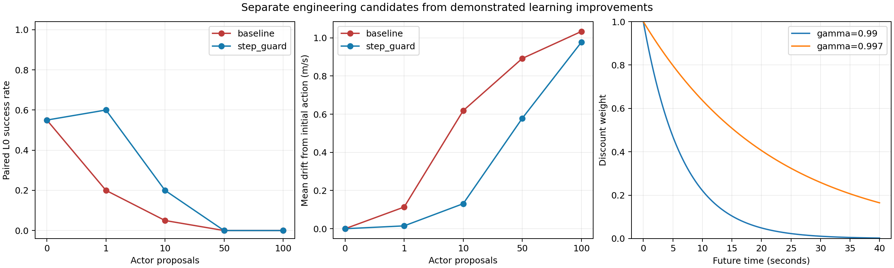

# Full EGO20x10：验收与下一步机制执行结果

**本轮完成了20k Critic完整验收、16m任务单因素工程验证、Actor单步保护短对照和冻结Actor的局部Critic校准短对照。当前两个训练机制候选都未满足进入大规模训练的条件。** 正式模式、奖励、GRU、课程、checkpoint保持原样，封存test40没有执行。

## 执行范围

旧7m/12s实验使用已有4k/10k/20k快照，没有重新训练20k；补齐与合并目标噪声控制。新16m/40s机制实验从原5k完整学习状态出发，使用原A真实Replay前缀与录制采样索引/目标噪声，各分支计算自己的TD target，不产生新在线训练经验。Actor保护两分支各200次Critic更新、100次Actor候选更新；校准两分支各200次Critic更新、Actor0次。

“不等待Critic完全正确”在这里体现为独立测试Actor步长保护，而不是在Critic方向未通过时继续长训。任务候选只做编码、奖励和物理一致性验证，本轮没有冒充完成其学习收益对照，也没有把不同输入编码喂给旧Actor比较成功率。

## 1. 旧7m Critic：绝对价值改善，局部指导未通过

| 累计步数 | 源Q1 MAE（确定性） | 源Q1 MAE（共同噪声） | 主动作排序一致率 | 主梯度一致率 |
| --- | ---: | ---: | ---: | ---: |
| 4000 | 9.940 | 9.259 | 45.7% | 53.8% |
| 10000 | 8.037 | 7.354 | 46.3% | 39.6% |
| 20000 | 5.371 | 4.634 | 52.1% | 42.0% |

20k第一层和第二层均未通过。噪声四副本仅排查价值定义混淆，不能替代完整主梯度/排序验收。此结果属于旧7m任务，不与新16m初始Critic数值混用。[完整验收与去重来源](../full_critic_frozen_v1_seed43/completed_review/REPORT.zh.md)。

## 2. Actor：限制每一步不等于保留导航能力

采用固定188条原5k训练状态，以世界速度变化约束mean≤0.02m/s、P95≤0.05m/s；必要时对同一Adam梯度减小有效LR。拒绝时恢复Actor、Actor Target、Adam，保留Critic更新。验证地图不参与此步长判据。无保护分支最终四个网络逐张量等于原A5200，两个分支的采样索引、目标噪声及末尾Torch RNG一致。

| Actor候选次数 | 原更新 L0成功/20 | 单步保护 L0成功/20 | 保护分支累计动作变化均值m/s |
| --- | ---: | ---: | ---: |
| 0 | 11 | 11 | 0.0000 |
| 1 | 4 | 12 | 0.0149 |
| 10 | 1 | 4 | 0.1311 |
| 50 | 0 | 0 | 0.5784 |
| 100 | 0 | 0 | 0.9765 |

100个候选都经回溯后接受；实际最大单步mean=0.01626m/s、P95=0.02234m/s，均在阈值内。第一步原mean=0.11357m/s，保护后0.01491m/s。一次更新后的12/20相对初始11/20属于小样本波动，不能称为学习提升。

到100次时保护分支平均az约0.955，尚未达到|az|≥0.999的“饱和”阈值，但L0已16/20高度越界、4/20碰撞。原更新100次L0同样16高度越界、4碰撞。两者原始16m均0/20成功，19/20 XY越界、1/20碰撞。**仅记录饱和率不足以发现持续错误偏置；单步上限也不能阻止累计漂移。**

边界：这是真实A行为Replay上的离线机制对照，数据包含A的坏行为；没有运行保护策略自己的在线采样。因此已证实“此共享数据与机制下单步保护不足”，尚未证明所有在线步长保护策略无效。2k/5k源Actor随机且相同，它的11/20 L0是初始行为，不代表已学会16m导航。

## 3. Critic局部校准：拟合可改善，跨地图方向证据不足

12个真实Full Replay状态，各轴使用源5k动作±0.15，共36对/72条真实Full分支。后续所有轴恢复同一固定5k Actor，仅第一动作不同；每条分支用fresh reset和原执行前缀，状态重建误差0，不使用save/restore。G为6s有限时域、γ0.99、缩放0.1。

预先按地图划分：5张拟合train地图、7状态、21动作对；3张内部检查train地图、5状态、15动作对。没有validation/test监督。额外损失为100·ΣMSE(Qj(s,a+)−Qj(s,a−),G+−G−)，与原TD损失合并后每次只进行一次Critic Adam更新。权重是单一机制探针，不作参数搜索。TD-only四网络逐张量匹配原D3 B5200。

| 分支 | 拟合Q1方向（可区分4对） | 内部检查Q1方向（可区分5对） | 拟合ΔG RMSE | 内部检查ΔG RMSE |
| --- | ---: | ---: | ---: | ---: |
| td_only | 75% | 20% | 0.02530 | 0.20059 |
| td_local | 100% | 40% | 0.01275 | 0.20511 |

最后再对5个内部检查状态，沿各自最终Q1梯度±0.15新执行20条Full分支。TD-only仅1对超过|ΔG|>0.005且方向错误；TD+local仅2对可区分，1对正确、1对错误。多数一动作局部干预的6s收益很小。**证据量不足，不能把40%相对20%当作校准通过。** 较大的近目标错误方向仍存在；拟合RMSE下降而内部检查RMSE略上升，也不支持直接采用。

局部方向监督已实现且能改变训练，但当前样本覆盖及有限时域定义尚不能保证有效Actor梯度。6s G不是无限时域平滑策略Q真值；本轮没有解冻校准分支Actor，没有作“校准后导航改善”的结论。

## 4. 16m任务：四项候选的工程效果已分别验证

| 单因素候选 | 具体变化 | 证据与结论 |
| --- | --- | --- |
| goal_range | 目标差除[20,10,2] | 当前固定目标任务6000条Replay的目标X饱和20.32%→0%；从未clip的绝对位置恢复，历史不变 |
| position_scale | x/10，y/5，(z−1)/1 | 位置块最大值19.93→1.75（高度允许到2.75，所以z不要求±1）；位置可精确反解，其他字段不变 |
| guidance_project | 仅将引导期望速度投影到XY≤0.8、Z±0.3 | 消除不可执行目标；对相同Full轨迹只改变相关跟踪成本，不改变成功球/终止/物理 |
| gamma997 | 0.99→0.997，每15Hz转移一次 | 半衰期4.60→15.38s；20s权重0.049→0.406；实际学习稳定性尚未测试 |

引导区2131真实状态中2.02%的原期望Z超出命令上限，平均成本率64.404→64.119奖励单位/s；不是近目标全部成本被修复。

五个候选（含baseline）分别执行16m起始短段、近目标上方、近目标下方，共15条Full空场物理诊断；相同脚本命令下，所有候选的逐tick位置、速度和动作逐元素相同，上层奖励与实际1–8下层tick求和误差0。上方入球控制的跟踪成本16.653→5.375，下方8.011→5.300；相同轨迹均成功。这些是控制/奖励探针，不是Actor成功率。

另完成5候选×4障碍Stage的真实train森林reset/step检查，10/20/30/40树、917D、Full 15Hz/120Hz一致。保持40s、0.2m成功球、1.2m引导、1.75m雷达、两套课程、网络/GRU与正式配置。尚未选择组合版本：提高gamma可能增加目标幅值/方差，归一化变化也要求一致转换Replay或重新从零学习。



## 5. 决策与下一步

**已证实：** 旧任务Critic延长训练仍未提供合格局部方向；新任务共享Replay短对照里单步保护只能减缓最初变化；当前局部校准在拟合集改善而检查集未通过；16m四项候选的单因素工程语义已验证。

**较强假设：** Actor需要同时限制相对保留策略的累计偏离，并在基本能力退化时回退；Critic方向监督需要更丰富的局部Full对照与不同运动状态覆盖。小型试验支持继续验证这些机制，不能保证其有效。

**仍未验证：** 归一化、目标编码或更长折扣是否提升学习成功率；成功经验采样组成及坏行为Replay对方向错误的独立影响；6s方向与完整剩余40s/平滑策略方向能否一致。当前证据不支持马上改奖励权重或GRU，也不支持盲目再加训练预算。

下一轮建议先做固定且一致编码的16m单因素学习对照；方向审计增加可区分样本量，按地图保留独立检查，并对接近终止、远目标与高度误差分组。Actor候选增加相对固定保留策略的累计约束，检查1/10/50/100次更新的L0及7/16m能力；Critic方向与导航能力都通过后再运行独立在线短段。当前**不启动10k/20k/240k正式续训**，不将任何候选注册为默认正式模式。

## 复现与产物

工程候选：[模块](../../scripts/ego20x10_contract_variants.py)、[物理探针](../../scripts/probe_ego20x10_contract_variants.py)；机制：[Actor短对照](../../scripts/run_ego20x10_actor_guard_pilot.py)、[Critic短对照](../../scripts/run_ego20x10_local_calibration_pilot.py)。入口均拒绝覆盖非空结果目录，新复现必须传入新的`--output`。

```bash
OMP_NUM_THREADS=2 MKL_NUM_THREADS=2 MPLCONFIGDIR=/tmp/uav-mpl \
/home/tequila/miniconda3/envs/drones/bin/python -m scripts.probe_ego20x10_contract_variants \
  --output analysis_outputs/ego20x10_contract_new
# 其他独立入口：run_ego20x10_actor_guard_pilot all / run_ego20x10_local_calibration_pilot
# 每次指定一个新的--output，不把它们作为正式续训命令。
```

17项测试通过，覆盖完整Actor/Target/Adam回退、无约束与原TD3一致、接受步长边界、局部权重0与冻结TD3逐张量一致、目标编码恢复、引导投影/终止不变、重复证据去重和冲突拒绝。346份原始输入/源码/checkpoint哈希未变；新在线训练转移0，test40执行0。

结果：[任务工程数据](../full_ego20x10_contract_corrections_v1/protocol.json)、[Actor配对验证](../full_ego20x10_actor_guard_pilot_v1/validation.json)、[Critic梯度分支](../full_ego20x10_local_calibration_pilot_v1/holdout_gradient_branches.json)、[综合机器数据](summary.json)。

过程中的`*_precheck`目录保留，但不参与最终证据：一次引导日志float32一致性修复，一次CPU线程数1与原A线程2的精确复现失败。最终目录通过相应一致性检查；未修改生产算法来绕过检查。
