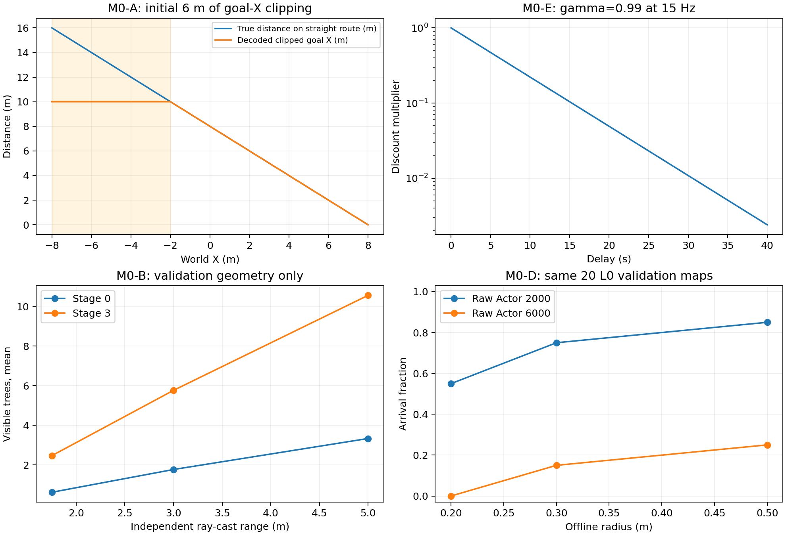

# full_ego20x10_task_contract_audit_v1

日期：2026-10-13。独立M0任务契约审计，seed43既有P0产物；与D3分离。本轮无训练、无D3执行、无奖励/GRU/课程/网络/正式配置修改。

## 两个核心问题的回答

**917D没有完全丢失16m目标距离，但专门的目标向量存在明确截断。** XY目标差除以10再截到±1，原始路线前6m的X分量一直等于1；6000条Replay中20.32%发生该截断。绝对位置保留且可反解，因此固定目标[8,0,1]仍能由位置推导距离。远处障碍不能从1.75m局部雷达恢复，800D历史也只覆盖约0.53s，并非全程地图记忆。

**奖励在全程鼓励接近目标，并非只在1.2m内跟踪速度；但当前学习分布中近目标跟踪成本很重。** 全局进展项为8Δ目标距离；21个完整训练episode的平均近目标跟踪罚分为390.72，平均终止项为-158.57，总回报为-575.07。另外，引导期望速度未受垂直0.3m/s限制，γ的物理时域明显短于16m完成时间。这些是任务契约问题，不等于已证明的6k崩溃根因。

| 任务 | 审计判断 | 证据等级 |
| --- | --- | --- |
| M0-A 状态 | 目标X远距离截断、输入尺度不均、历史不含位姿且窗口短；当前坐标未截断 | 代码与Replay已证实；影响学习程度未验证 |
| M0-B 感知 | 最大速度下可见单树的制动预算足够；远程路线信息有限；未证明必须3–5m才可导航 | Full制动实测＋validation几何探针；闭环学习收益未验证 |
| M0-C 奖励 | 全程进展有效；近目标成本可超过成功奖励；部分3D引导速度超出命令可行域 | 原公式、真实逐tick重构、隔离Full回报已证实 |
| M0-D 目标 | 1.2m引导、0.2m严格球正确；0.3/0.5指标已补齐 | 离线到达已证实；修改成功条件后的学习效果未验证 |
| M0-E 任务 | 40s没有几何不可行证据；γ=0.99/15Hz半衰期4.60s，长任务远期信号弱 | 几何与Full空场实测＋折扣计算；森林动态完成率待验证 |

## 范围、数据与复现

采用原始2k/5k/6k快照、6000条Replay、21个完整训练episode、60条16m validation轨迹及既有60条L0 validation记录。逐tick重构60条validation加7条保存的训练轨迹，共222389个120Hz tick；其中训练保存集含一条预算截断，不代表21episode总体。2k和5k Actor相同，两者不是独立样本。几何只统计train128、validation20的Stage 0–3；感知探针每个Stage抽20地图×3路径位置。

test40没有执行策略、没有用于统计或候选选择。生产ForestPool构造器按既有方式加载统一manifest并校验池指纹；本审计没有请求test split环境/路线或重新生成地图。物理探针是独立空场，用原Full/DSLPID、速度/加速度约束、奖励和终止规则，既不训练Actor也不采集正式Replay。

生产Full每120Hz tick积分；本隔离工厂显式将诊断reward.integration_dt对齐1/120，避免旧K1诊断工厂8/120默认值。全部逐tick奖励重构最大误差0；6条已完成保存训练轨迹的分项与生产episode日志一致。44份原checkpoint/生产文件SHA256前后未变。完整保护结果见[protection_result.json](protection_result.json)。

复现工具：[审计脚本](../../scripts/audit_full_ego20x10_task_contract.py)、[报告/绘图脚本](../../scripts/summarize_full_ego20x10_task_contract.py)。先依次运行state_reward、sensing_time、physics、report；首次state_reward要求输出目录不存在，避免覆盖既有审计。报告脚本只渲染已完成结果。

## M0-A：117D当前观测与800D历史

| 索引（0起） | 内容 | 编码与限制 |
| --- | --- | --- |
| 0–11 | 位置3、姿态3、线速度3、角速度3 | 位置减[0,0,1]再除0.5；姿态/π；速度/2；角速度/4；均未clip |
| 12–14 | 三维目标差 | 除[10,10,2]后clip到±1 |
| 15–110 | 96条雷达 | 32方位×[-30°,0°,30°]；中心距离/1.75，未命中为1 |
| 111–113 | Reference位置差 | /0.5后clip到±4（真实±2m） |
| 114–116 | Reference速度 | /2后clip到±1 |
| 117–916 | 8×100历史 | 每帧96雷达＋3归一化上一命令＋1平均跟踪误差/0.5，标量clip到[0,4] |

代码：[目标编码](../../envs/forest/core.py:398)、[预处理](../../envs/preprocess.py:6)、[当前与历史编码](../../envs/learned_upper_dslpid.py:158)、[GRU](../../algos/td3/td3_upper_recurrent.py:76)。

6000条输入均有限，历史平移逐元素一致，末帧雷达与当前雷达逐元素一致，无917D布局错误。历史8帧的最老时间戳落后当前7/15=0.467s；覆盖8个决策间隔约0.533s。在0.8m/s下只对应约0.43m运动。GRU每次forward重新初始化隐状态，只有显式窗口内的记忆；历史没有位姿/速度/目标，无法直接用位姿序列对齐世界障碍。

从x=-8至-2，真实X目标差16→10m，编码一直为1；绝对X编码则-16→-4，仍可区分位置。对当前固定终点，不能声称整个917D把所有远距离状态混为一谈；对目标迁移或任务泛化，截断丢失了目标差大小，绝对位置不能替代未知新终点。近目标编码0.2m仅0.02，而x≈8的绝对位置编码≈16，数值尺度相差数百倍。它提示归一化需审核，但不是梯度失稳的直接证据。

| Replay特征块 | 最小 | 最大 | RMS |
| --- | --- | --- | --- |
| position | -19.96 | 19.93 | 8.535 |
| rpy | -0.07138 | 0.06601 | 0.01652 |
| velocity | -0.4675 | 0.4378 | 0.116 |
| angular_velocity | -0.3537 | 0.33 | 0.08982 |
| goal | -0.8745 | 1 | 0.301 |
| rays | 0.05977 | 1 | 0.9833 |
| reference_error | -0.1329 | 0.125 | 0.03279 |
| reference_velocity | -0.3995 | 0.3975 | 0.1089 |
| history_rays | 0.05977 | 1 | 0.9838 |
| history_commands | -1 | 1 | 0.5887 |
| history_tracking_error | 0 | 0.1582 | 0.05635 |

另有剩余时间、PID积分/RPM历史等隐状态未显式提供。隔离探针保持917D完全相同，将时钟置于39.995s后，同一动作产生timeout，正常时钟继续运行；注入PID积分也改变后继状态。这证明观测不是完整马尔可夫状态，但注入探针不能说明这些具体别名在真实Replay中经常出现，也不能说明800D当前设计无法学习。[隐状态探针](M0A_hidden_state_aliases.json)。

## M0-B：1.75m有效绕障提前量

雷达为世界方向、中心z+0.02，射线起点外移0.08m；1.75m是中心到命中面的量程。树木净空扣除无人机半径0.06m，安全罚区从净空<0.35m开始。若树被及时看见，在0.8m/s直冲下，量程边缘至接触约(1.75−0.06)/0.8=2.11s，至安全罚区约(1.75−0.06−0.35)/0.8=1.68s。

Full实测从0.8009m/s停止，前冲0.378m，0.733s降至0.05m/s以下。90°左右转向也前冲约0.378m。再加一次上层决策等待的约0.053m，总约0.431m，低于1.34m的可用安全距离。因此单个可见树的局部制动并不要求先加大量程。参考加速度为XY每轴1.0m/s²、Z0.5m/s²；不能用类别默认1.5替代当前配置。

独立用PyBullet同样的32条水平射线测试1.75/3/5m，未改生产range。1.75m复核与真实传感器最大差0.0013m。理想解析圆柱在一个擦边位置出现约1.02m命中/漏命中差，因此最终统计采用物理射线，不把解析模型当真实传感器。更长量程维持32方位时，远处小树的角宽也可能低于11.25°采样间隔；量程增加不等于覆盖整个远区。

下表使用“只知道当前命中树、其余视作空闲”的乐观几何路线，比较全图安全路线。两者都可使用命中树的精确几何，能力强于Actor实际输入，目的只是量化未见障碍信息。

| Stage | 量程m | 平均命中树数 | 初始路线方向差>15° | 乐观全剩余路线触碰未见膨胀障碍 |
| --- | --- | --- | --- | --- |
| 0 | 1.75 | 0.62 | 0.0% | 25.0% |
| 0 | 3.0 | 1.77 | 0.0% | 21.7% |
| 0 | 5.0 | 3.33 | 0.0% | 21.7% |
| 3 | 1.75 | 2.47 | 0.0% | 66.7% |
| 3 | 3.0 | 5.77 | 3.3% | 60.0% |
| 3 | 5.0 | 10.57 | 3.3% | 53.3% |

Stage 3在1.75m下平均仅见约2.47/40棵，乐观剩余路线经常碰到未来未见树；这是远程路线不可观测的证据，**不是必须远程规划才能成功的证据**，因为局部控制会继续获得新观测。本样本的1.75m初始方向差>15°为0/60，不能据此声称目前路线经常要求更早作大幅绕行决策。3/5m增加可见树数，但仍有未来未知，方向统计不单调。动态遮挡、死胡同与闭环重规划尚未量化；建议保留3–5m为之后单因素验证候选，而不是本轮更改输入。[几何记录](M0B_perception_routes.json)、[Full制动记录](M0B_full_braking_turning.json)。

## M0-C：奖励完整契约

以下R表示任意奖励单位，不是焦耳；米、秒、弧度为物理量。d为三维终距，c为扣除车体后的树木净空，e_z=z−1，q为原始起点到终点直线的投影距离。运行tick使用：

`r_tick = 8(d_prev−d) − (所有启用的成本率之和)/120`。

终止tick只发互斥结局奖励，不再发该tick进展与成本；`r_upper`是实际执行的1–8个tick求和（一般8，提前终止可以不足8），Replay乘0.1，TD3 γ=0.99每上层转移。terminal_outcome、goal_bonus、collision_penalty为重复日志别名时只计一次。[正式奖励实现](../../envs/forest/rewards.py:336)、[rate积分](../../envs/forest/rewards.py:442)、[引导公式](../../envs/forest/rewards.py:551)。

| 分项 | 公式/系数 | 范围 | 系数量纲；积分 |
| --- | --- | --- | --- |
| progress_reward | +8(d_prev−d)；route_progress系数0 | 全程 | 8 R/m；距离差，不乘dt |
| distance_reward | 0 | 禁用 | 0 |
| time_penalty | 0.25 | 全程运行 | R/s；乘dt |
| height_penalty | 0.8·abs(e_z) | 全程运行 | R/(m·s)；乘dt |
| vertical_speed_penalty | 0.12·abs(vz) | 全程运行 | R/m；乘dt |
| lateral_penalty | 0.15·侧向距离再乘0 | 禁用 | 基础系数R/(m·s) |
| proximity_penalty | 30((0.35−c)/0.35)² | c<0.35m | 30 R/s；乘dt |
| attitude_penalty | 0.10(abs(roll)+abs(pitch)) | 全程运行 | R/(rad·s)；乘dt |
| speed_penalty | 0.003·norm(v) | 全程运行 | R/m；乘dt |
| near_goal_speed_penalty | 权重0；旧radius0.8 | 禁用 | 基础形式权重R·s/m² |
| near_goal_away_penalty | 权重0；旧radius0.8 | 禁用 | 基础形式权重R/m |
| route_overshoot_penalty | 5·max(0,q−16)² | 越过终点投影平面 | R/(m²·s)；乘dt |
| safety_boundary_penalty | 25·max(att_ratio,z_ratio)² | 姿态>.50rad、z<.15或z>2.60 | 25 R/s；乘dt |
| near_goal_velocity_tracking_penalty | 160·activation·norm(v−v_des)² | d<1.2m | R·s/m²；乘dt |
| success terminal | +250 | d<0.2m | R；一次 |
| collision terminal | −300 | 碰撞 | R；一次 |
| bounds terminal | −250 | XY/高度/姿态越界 | R；一次 |
| timeout terminal | −180 | 超过40s | R；一次 |

边界ratio：姿态(abs最大roll/pitch−.50)/.15；低高度(.15−z)/.07；高高度(z−2.60)/.15；各clip到[0,1.5]。引导activation=clip((1.2−d)/.2,0,1)，期望速率=.1+.7·clip((d−.2)/1,0,1)，方向指向三维目标。

其他日志量不应重复加入reward：goal_progress、route_progress为米；near_goal_desired_speed、near_goal_closing_speed为m/s；continuous_penalty_total是成本积分的汇总；running_shaping_reward是已含进展和成本的汇总；interval_total是上层实际奖励汇总。

8Δd在未折扣总和中近似望远镜求和（终止tick进展被省略），但不是当前γ=.99下的`γΦ(s_next)−Φ(s)`形式，因此不能称作保证策略不变的折扣势函数shaping。折扣后更早接近目标更有价值；这不自动证明存在可获利的循环，因为时间、运动及边界成本也要计入。

运行进展奖励在理想0.8m/s径向接近时约6.4 R/s，减时间/速度成本后约6.148 R/s（零倾斜/高度差/净空罚）；16→.2m总进展约126.4R。近目标固定d=.8m悬停的跟踪率为160·.52²=43.264 R/s；连续5s即可216.32R。40s恒定成本示例：时间10R、|e_z|=.3m时9.6R、|vz|=.3m/s时1.44R、净空c=.2m时220.41R。这些是指定常态的率积分，不是同一可实现飞行的分项上限。

**引导可行域缺口：** 期望三维速度不做XY/Z投影。纯垂直目标差d=.8m时要求|vz|=.52m/s，但命令上限.3；即使达到上限，剩余速度误差.22对应至少7.744 R/s跟踪罚。在d=1m纯垂直方向时最低20.736 R/s。Replay引导区2131条状态中2.02%的期望垂直分量超过上限；不是所有近目标状态都不可行，也不是瞬时物理速度的严格硬界（Full可能短时超调）。[可行性扫描](M0C_guidance_feasibility.json)。

**真实累计贡献：** 下表成本按正数列出，实际reward做减法，进展/终止保留符号。训练是所有21完整episode；validation每列20地图。5k与2k完全相同。训练保存子集含预算截断，故不作为总体均值。

| 分项 | 训练21回合均值R | 2k/5k 16m均值R | 6k 16m均值R |
| --- | --- | --- | --- |
| progress_reward | -14.1265 | 19.0351 | 32.4345 |
| terminal_outcome_reward | -158.5714 | -186.0000 | -252.5000 |
| time_penalty | 4.2746 | 9.7794 | 1.4870 |
| height_penalty | 3.2198 | 20.9729 | 3.9098 |
| vertical_speed_penalty | 0.1804 | 0.1563 | 0.2037 |
| proximity_penalty | 1.0261 | 2.4647 | 1.1692 |
| attitude_penalty | 0.1718 | 0.0040 | 0.0247 |
| speed_penalty | 0.0171 | 0.0087 | 0.0139 |
| route_overshoot_penalty | 1.1695 | 0.0000 | 0.0000 |
| safety_boundary_penalty | 1.5863 | 0.0000 | 3.8817 |
| near_goal_velocity_tracking_penalty | 390.7227 | 0.0000 | 0.0000 |

训练结局：3成功、6timeout、8高度越界、4XY越界。训练平均回报-575.066R；2k/5k验证平均-200.351R，平均持续39.126s；6k验证平均-230.755R，平均5.956s。所有原始16m验证都未进1.2m，所以该组引导罚分为0；不能把它们的失败直接归咎于当回合引导罚分。

保存的真实近目标成功之一累积跟踪罚712.698R，即使最后+250，整回合仍为−462.972R；另两个保存成功分别+238.092、+236.059（后者不在7条lower轨迹子集，来源既有成功Replay审计）。这是“成功轨迹也可能为负回报”的实证，尚不能把它等同于最优成功轨迹必定低于失败轨迹。逐tick、区域分拆与所有episode分布见[M0C_real_reward_components.json](M0C_real_reward_components.json)、[训练总体统计](M0C_training_episode_summary.json)。

**完整40s Full参照：** 空场、同一原始16m起点，使用相同正式成功球/时限。scheduled_capture按原引导速度减速，flyby始终+x .8m/s；均为脚本控制，不是Actor表现。

| 控制协议 | 结局 | 秒 | 总原始R | γ折扣原始R | 引导累计成本R |
| --- | --- | --- | --- | --- | --- |
| hover_40s | timeout | 40.017 | -190.002 | -2.096 | 0.000 |
| scheduled_capture | success | 21.792 | 370.075 | 45.905 | 0.797 |
| max_speed_flyby | success | 20.142 | 338.806 | 46.915 | 32.451 |

hover超时在40.0167s而不是恰好40s，原因是正式规则严格`>40`并受物理tick离散化影响。scheduled_capture成功原始回报更高，但γ折扣后flyby略高；这证明这一空场控制对的奖励排序随折扣发生变化，并非森林中快飞必然更优。当前成功判定无入球速度约束，所以flyby也合法成功。[40s完整Full预算](M0C_full_40s_reference_budgets.json)。

## M0-D：目标定义与离线0.3/0.5m

严格3D `distance < 0.2m`为成功；引导仅`distance < 1.2m`启用，1.2→1.0m渐入；旧near_goal_radius=.8的速度/离开罚分都禁用，不是新的成功球。没有入球驻留/速度条件。终止优先顺序为成功、碰撞、XY越界、高度越界、姿态越界、timeout；若同tick入球且碰撞，会先判成功，应在未来安全评估另列接触标记。[终止代码](../../envs/forest/core.py:504)。

| 验证任务 | Actor步数 | <0.2m | <0.3m | <0.5m |
| --- | --- | --- | --- | --- |
| validation16m | 2000 | 0/20 | 0/20 | 0/20 |
| validation16m | 5000 | 0/20 | 0/20 | 0/20 |
| validation16m | 6000 | 0/20 | 0/20 | 0/20 |
| L0_upper_sampled | 2000 | 11/20 | 15/20 | 17/20 |
| L0_upper_sampled | 5000 | 11/20 | 15/20 | 17/20 |
| L0_upper_sampled | 6000 | 0/20 | 3/20 | 5/20 |

原始16m所有2k/5k/6k策略均0/20进入1.2m。训练21回合的120Hz最低终距统计，<.2/.3/.5/1.2m分别3/3/9/16。L0起点来自原验证地图的QA近目标位置，仍有10棵树，先前固定剩余路径约.8m；其first crossing与速度只按15Hz既有样本统计，会漏掉两个上层采样之间的短暂入区；16m轨迹和生产episode最小终距为120Hz。

0.3m是值得优先考察的候选，0.5m可作辅助区域到达，0.2m继续保留。但这些是原任务提前终止后的离线入区率，不能宣称是修改任务后的成功率。6k的3/20进入.3m并不修复后续XY/碰撞失败，也不修复16m导航。逐回合首次入区时间/速度、严格结局见[M0D_offline_arrivals.json](M0D_offline_arrivals.json)。

## M0-E：40s、gamma、路径与课程匹配

动作为3D速度，XY投影到半径.8m/s圆盘，Z±.3m/s；不是XY各.8可同时实现。参考加速度XY每轴1.0m/s²、Z.5m/s²，120Hz DSLPID执行，每8tick一条15Hz转移。理论直线到严格球边界16−.2=15.8m，忽略启动/减速的下界19.75s；按原引导速度减速则约21.47s，实测21.79s。

几何QA为四邻域BFS，车体半径.06、安全余量.20、网格补偿约.071m；因此QA长度往往比连续可达路线长。以下同时给出贪心视线平滑后、仍保留.26m圆柱膨胀的路线。**它们是具体可行几何路线长度，不是全局最短，也不是Full动态可行保证。** 长度/.8只表示沿该路线不计转弯/启动/减速的理想耗时。

| 池 | Stage | QA长度均值/最大m | 平滑长度均值/最大m | 平滑理想耗时均值/最大s |
| --- | --- | --- | --- | --- |
| train | 0 | 16.56 / 17.94 | 16.09 / 16.62 | 20.12 / 20.77 |
| train | 1 | 16.98 / 18.74 | 16.18 / 17.03 | 20.23 / 21.29 |
| train | 2 | 17.38 / 19.54 | 16.28 / 17.48 | 20.36 / 21.85 |
| train | 3 | 17.81 / 19.94 | 16.39 / 17.69 | 20.49 / 22.11 |
| validation | 0 | 16.43 / 17.62 | 16.06 / 16.33 | 20.07 / 20.41 |
| validation | 1 | 16.92 / 18.22 | 16.18 / 16.78 | 20.22 / 20.98 |
| validation | 2 | 17.38 / 19.02 | 16.22 / 16.83 | 20.27 / 21.03 |
| validation | 3 | 17.74 / 19.22 | 16.32 / 17.41 | 20.39 / 21.76 |

train/validation592条分Stage几何路线均可达。40s允许最大理论行程32m，现有安全几何路线没有超过这一预算；但转向、高度调整、停顿、未知地图选择与Full跟踪需额外时间，没有做全森林脚本成功率认证。因此应保留“40s几何上可行、实际学习策略是否足够另查”的判断，而不是直接加时限。

γ=.99每15Hz转移：半衰期4.598s；几何有效期1/(1−γ)/15=6.667s（不是硬截断）。20/30/40s折扣因子0.04904/0.01086/0.002405；+250终点奖励在起点分别只值12.260/2.715/.601R，Replay再×.1。全过程局部进展能提供连续信号，所以远期奖励衰减不等于绝对不能学习，但与16m约20–25s任务相比，折扣目标明显偏短。[折扣表](M0E_discount.json)。

课程的距离按QA剩余路径而非直线终距：L0 [.35,1.2)、L1 [1.2,4)、L2 [4,8)、L3 [8,∞)、L4原始起点；原始起点保留概率20/20/30/50/100%。近目标候选必须距目标>.30且树净空≥.18。各距离带只由至少100个band回合、窗口成功≥70%、碰撞≤20%晋级；原始起点混合不帮助短带晋级。障碍Stage 0–3为10/20/30/40树，只有起点课程完成后的原始起点回合可用于晋级；窗口100，成功阈值80/75/70%，碰撞上限15/20/20%。保持难度保留机制，内部简单阶段混合为0。

从L0到原始16m，导航耗时和折扣终点权重变化很大；所有课程回合共享40s，没有按带缩短时限。当前仍只有21个完整episode，不能据此认定课程已经完成距离扩展。[课程](../../envs/forest/ego_curriculum_env.py:11)、[起点晋级](../../envs/forest/start_curriculum.py:61)、[障碍晋级](../../envs/forest/obstacle_curriculum.py:35)。

## 证据边界与下一版候选（本轮均不执行）

**已证实：** 目标向量远距截断；未截断绝对位置可补偿固定目标；显式历史短且没有位姿；全程8Δd奖励生效；部分引导垂直速度超过命令域；成功回报可能为负；γ物理半衰期短；40s空场能完成16m；原始16m失败不是放宽.2→.3能解决。

**较强但待验证的解释：** 目标特征的截断与尺度、近目标重罚造成的训练样本回报结构、以及短折扣时域，可能阻碍距离课程扩展。M0并未训练反事实策略，不能给这些机制分配因果贡献，更不能替代已有Critic失稳时序证据。引导域越限仅占引导Replay约2.02%，不能把它夸大成全部样本不可学。

**尚未证实：** 1.75m就是森林失败根因、3–5m必能改善、多尺度地图输入是必需、.3m成功半径会稳定训练、增大gamma会解决6k崩溃。

建议下一版先形成独立合同对照：目标距离无截断编码及尺度校准、引导速度按同一执行域投影、明确奖励/折扣的物理时间目标。三者分别验证，不捆绑修改；继续同步记录.2/.3/.5到达，把.3作为候选成功球单独对照。感知量程3/5m留到局部导航基线稳定后，保持方位分辨率因素可区分。保留Recurrent TD3、3D速度、Full/DSLPID；Reference Sequence放到基础导航可靠之后。

M0支持先审核任务合同再耗费大规模预算；它没有授权或执行D3。D3机制审计仍按原独立协议解释，任何未来改奖励/状态/时域的实验需要新的配置名和独立产物，不混入当前正式run。

## 验证与产物

四项诊断测试通过：终止tick重构不受浮点40s时间误差影响；几何平滑保留障碍净空；实际Full首条Replay状态/奖励一致；fresh reset＋动作前缀重建PID/packet/历史可重复。原始44文件保护通过；训练更新0，test策略执行0。科学图同时保存PNG/PDF。所有新增结果均在本目录，未覆盖checkpoint或原训练日志。
