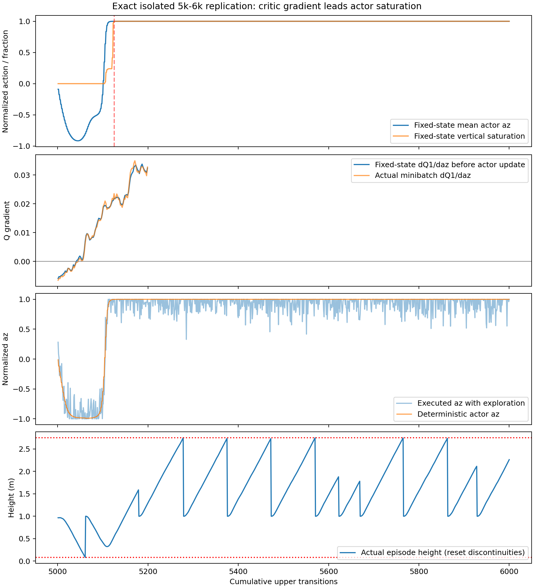

# Full Scratch EGO20x10：P0异常归因与Actor–Critic价值审计

2026-10-13，seed43。仅诊断：未修改奖励、GRU、网络、课程或正式训练配置；没有10k/20k续训，没有reset、飞行或选模使用test40。所有新网络、数据和图放在本独立诊断目录，正式checkpoint及训练日志保持原样。

**核心判断：策略更新确实发生了快速、可精确复现的垂直反转和饱和；Critic的动作梯度变化领先于饱和。下层正常执行了这些命令。价值估计未充分适应、Actor过早利用局部Q斜率，是目前较强假设，尚不是经D3消融证实的唯一根因。**

## 1. 精确复现及崩溃时序

5k完整快照没有进行中PyBullet/PID/reference物理快照，因此不能直接reset后称为精确复现。本次从原2k续训边界恢复课程、起点及地图RNG，再用原Replay动作重放2001–5000步，恢复进行中回合、PID、reference packet、917D历史与147条未结束回合成功候选；3000步的前观测最大误差为0，下一观测、真实奖励和done mask核对通过。

随后恢复5k网络、targets、Adam、主/成功Replay及全局RNG，执行隔离5001–6000：1000次新增Critic、500次Actor更新。最终四个网络hash、主Replay、成功Replay与地图采样器全部等于原6k。5k已有1次Critic更新，因此最终累计1001次Critic；Actor累计500次。没有运行原best/selected恢复流程，所有保存均为raw。

每100转移保存Actor/Critic、Adam和target state，记录训练计数；统一固定状态集为5k真实Replay中188个去重状态，覆盖近/远目标及目标上/下方，选择索引随数据保存。另精确重跑5001–5200，以每次Actor更新前的固定集梯度和实际minibatch梯度细化时序；5200四网络hash也与主复现分支一致。

| 事件 | 累计上层步 | 累计Actor更新 | 说明 |
|---|---:|---:|---|
| 开始执行Actor+探索噪声 | 5000 | 0 | 判断是`step < start_timesteps`；此步仍是初始Actor |
| 第一次Actor更新 | 5001 | 1 | 此时Critic累计仅更新2次 |
| 固定集平均dQ1/daz持续转正 | 5043 | 22 | 连续至少10次Actor更新均值保持正，并非每个状态都同时转正 |
| 固定集垂直动作负向极值 | 5045 | 23 | 均值−0.9161；先有下探，后有爬升 |
| 首个在线更新后的高度失败 | 5061 | 31 | **下界**，终止高度0.07977m |
| 固定集垂直均值越过+0.5 | 5105 | 53 | 快速反转 |
| 固定集垂直均值越过+0.9 / +0.99 | 5109 / 5115 | 55 / 58 | 正向饱和形成 |
| 188状态全部达到正向饱和阈值 | **5125** | **63** | az≥0.999；实际访问状态首次确定性az≥0.999在5127 |
| 首次上界高度失败 | 5278 | 139 | 终止高度2.75148m |

这不是单纯的“到6k才突然坏掉”。前约45步先趋向负垂直，Q斜率转向后迅速爬升，在仅63次Actor更新后固定集全部饱和。所有时间都限定于本seed和记录的状态集合，不能推广为所有状态的首个饱和时刻。

| checkpoint | Actor更新 | 动作均值(ax,ay,az) | 径向命令m/s | Q1 / Q2均值 | 相邻固定策略RMS |
|---|---:|---|---:|---|---:|
| 5000 | 0 | (0.296,−0.024,0.003) | +0.183 | −0.069 / −0.182 | — |
| 5100 | 50 | (−0.136,−0.941,−0.179) | +0.249 | −0.128 / −0.154 | 0.730 |
| 5200 | 100 | (−0.795,−0.605,1.000) | **−0.305** | −0.012 / +0.005 | 0.909 |
| 6000 | 500 | (0.770,0.469,1.000) | +0.325 | −0.605 / −0.412 | 0.197（5900→6000） |

XY也发生明显变化，5200甚至平均径向背离目标。不能将整个失败简化为一个垂直轴问题。Q分布、三轴动作、局部梯度及相邻RMS原始结果见[timeline_probes.json](timeline_probes.json)。



## 2. Actor梯度与饱和的关系

实际Actor损失为`−mean(Q1(s, actor(s)))`，已用forward/backward hook捕获实际输出梯度。5105的实际训练batch平均dQ1/daz约+0.02099，对应输出损失梯度约−8.20e−5，垂直输出层bias梯度约−0.01960；梯度下降方向确实推动垂直输出增大。这是实际更新证据，不是仅用更新后的Critic倒推。

固定集平均dQ1/daz在5000为−0.00501、5100为+0.01821、5200为+0.03345；对应固定XY的z扫描也从偏好下降转为偏好爬升。5043的固定集平均梯度变正领先于5125饱和82个转移。实际batch与固定集包含不同状态，初期平均梯度可不同，不能把所有状态/参数更新视作同一条标量梯度。

Actor头部输入范数均值从3.56增至23.03，5200垂直logit均值6.668；`1−tanh(logit)^2`均值约8e−6。**饱和后输出对logit的一阶响应极弱是已证实事实**；“无法恢复”没有经过后续预算验证，不能断言。

5200当前Actor az均值≈1，target Actor仅≈0.070；5300 target才约0.669。这是按原tau=.005正确运行的滞后，不是同步错误。策略变化快于target/价值估计适应，可能加剧失配，但仍需消融分离其作用。

## 3. 排除warmup执行动作切换的误判

训练执行动作包含探索；确定性Actor动作单独保存。4950–4999的随机执行az均值约−0.001、std约0.587，而同状态初始Actor az均值约−0.019。5000单步确定性az约−0.0074，执行az因探索约+0.2646。

到5125–6000，确定性Actor az均值约+0.9999，实际执行均值约+0.9292（噪声及clip使之较低）。固定共同状态集的Actor本身已饱和，并且2k/5k Actor hash相同。因此暖身结束确有分布切换，但**不能单独解释后续网络自身的反转与持续饱和**。见[warmup_execution_switch.json](warmup_execution_switch.json)。

## 4. TD target及成功Replay

1000次实际更新均核对：主Replay205条+成功Replay51条；从保存RNG重构target noise，检查clip、XY投影及target动作，再核对Q1_target/Q2_target：

```text
target = scaled_reward + not_done × 0.99 × min(Q1_target, Q2_target)
```

重构Critic loss最大误差为0。终止/timeout按原契约mask=0，target直接等于scaled reward，没有额外bootstrap。成功池实际仅10树层；所有sampled state/action/next/reward/mask与对应原Replay数组完全一致。

1000批采样索引与target noise已从5k RNG独立再生，6个实际捕获batch逐元素验证；最终NumPy与Torch RNG也等于原6k。可供未来共享batch消融使用，**此次未执行D3**。见[batch_schedule_proof.json](batch_schedule_proof.json)、[td_components.json](td_components.json)。若含终止样本，若干捕获batch中终止样本占target平方和约97%；这是target数值质量分布，**不是精确loss或梯度贡献率**。

成功Replay297条仅来自3回合：248、21、28条。248步的慢成功占83.5%，其原始回报为−462.97，包含约712.70累计近目标速度跟踪惩罚；两条短成功回报约+238.09、+236.06。297条sample并非297条独立成功轨迹。

| 成功Replay统计 | 数值 |
|---|---:|
| az均值 / std | −0.01974 / 0.57867 |
| 正az比例 | 45.79% |
| az饱和比例 | 0.34% |
| 高度均值 / 范围 | 0.9986m / 0.8719–1.1589m |
| 每转移高度变化均值 | −0.000346m |
| scaled reward均值 / 中位数 | +0.00376 / −0.20204 |
| 正reward比例 / 成功终止样本 | 3.37% / 3条 |

**不存在明显“成功样本总是向上”的动作偏置。** 但成功数量少、邻近转移相关、长慢轨迹占主导，是明确的数据限制；是否导致错误Q斜率是待验证假设。完整主池对照见[values_rebuilt/success_replay_bias.json](values_rebuilt/success_replay_bias.json)。

## 4A. Critic排序与配对Full回报

选取12个真实训练状态：设计时近/远/上/下各取3个，最终统计按实际世界条件重新分组，条件可重叠。近为3D终距<1.2m，远为≥4m；上/下分别是z−z_goal>0.15m / <−0.15m。因此最终分组数量为近3、远4、上5、下4，合计不是16个独立状态。

每个状态从该episode reset开始，逐原始动作重建完整物理/PID/reference/history，观测最大误差0。扫描az∈{−1,−0.5,0,0.5,1}，实际垂直命令对应{−0.3,−0.15,0,+0.15,+0.3}m/s；**只对第一上层决策改变z，XY相同**。之后统一使用冻结6k Actor闭环控制，另用相同的路径/高度反馈控制做物理可恢复性对照；没有将初始XY固定到整个回合。总计120个有限时域分支，加同状态同动作重建复验，全部重复一致。

记录5k/6k Q1、Q2、min及各Actor实际动作价值；主要一致性判断用6k Critic对其冻结6k后续策略的30/90决策（2/6s）折扣回报。也保存非终止时的min-Q尾值bootstrap，不能把尾值仍含模型偏差的结果称作真值。示例数据及显式世界速度见[paired_vertical_values_world_groups.json](paired_vertical_values_world_groups.json)。

90步回报的成对排序一致率如下，排除return差<1e−6或Q差<1e−7的tie。每个状态5动作最多10对，**这些对不是相互独立样本**。

| 真实分组 | 状态数 | Q1一致/反向/平局 | Q1一致率 | Q2一致率 | min一致率 |
|---|---:|---|---:|---:|---:|
| 近目标 | 3 | 8 / 22 / 0 | **26.7%** | 23.3% | 26.7% |
| 远目标 | 4 | 2 / 30 / 8 | **6.25%** | 6.25% | 6.25% |
| 目标上方 | 5 | 28 / 16 / 6 | 63.6% | 38.6% | 63.6% |
| 目标下方 | 4 | 20 / 18 / 2 | 52.6% | 7.9% | 52.6% |

近/远目标排序在此有限样本和时域下明显不可靠；两个Critic取min也没有在这些状态中修复排序。上/下组并非统一反向，不能说所有状态的垂直价值都估反了。

改用路径/高度反馈后，Q1一致率为近80.0%、远54.5%、上25.0%、下38.5%，并有较多平局。这说明后续控制协议会改变动作的实际收益；该控制器不等于Actor策略，其结果只用于可恢复性诊断，**不能用于判定当前策略Q的精确误差**，也不能称为训练改进。零z的效用只在同状态、同首步XY和同后续控制下比较，未把固定XY越界归咎于零z。

即使使用Actor后续协议，有限时域、确定性控制、target策略滞后及target smoothing仍与无限时域训练目标有区别。所以上述是价值排序失配的直接有限时域证据，支持“价值校准不足”的较强假设，不能认定一个独有的算法根因。

## 5. 相同地图的原始Actor评估

Stage0，固定validation20；没有训练探索噪声。原始16m使用此前已存在的同图raw轨迹，核验来源Actor hash后在本目录重新统计。2k和5k Actor逐参数相同，L0结果在验证hash后复用，避免把重复飞行当作独立样本。

L0每图取缓存安全路径剩余长度最接近0.8m的点，统一z=1、速度/姿态/PID/reference/history正确reset，固定同一起点供各Actor比较；不是带20%原始起点混合的训练SR。

| 地图/起点 | Actor | 成功 | 碰撞 | 高度越界 | XY越界 | timeout | 平均最小终距m | 引导区进入 | 平均跟踪误差m |
|---|---|---:|---:|---:|---:|---:|---:|---:|---:|
| 原始16m | 2k / 5k | 0/20 | 1/20 | 0/20 | 0/20 | 19/20 | 13.620 | 0% | 0.00089 |
| 原始16m | 6k | 0/20 | 1/20 | 19/20 | 0/20 | 0/20 | 11.940 | 0% | 0.01563 |
| L0固定近起点 | 2k / 5k | **11/20** | 0/20 | 0/20 | 9/20 | 0/20 | 0.293 | 100% | 0.00726 |
| L0固定近起点 | 6k | **0/20** | 2/20 | 0/20 | 18/20 | 0/20 | 0.525 | 100% | 0.01954 |

2k/5k的55%是随机初始化Actor在这些近起点上的表现，不能称为已学习的成功率。L0初始位置本就在引导区，100%进入比例不证明导航能力。6k L0的XY越界通常先于高度达到上界，所以“没有高度越界”也不代表垂直策略健康。

原始16m的19个高度失败均从零初速度开始，持续命令约+0.29998m/s，末端实际vz约+0.29997m/s；垂直速度相对reference跟踪RMSE平均0.00473m/s，平均约6.125s终止，上界2.75m。最大roll/pitch绝对值的回合均值约0.148rad。证据支持上层持续爬升导致越界，不支持初始速度或下层姿态/跟踪异常。训练的7次在线高度失败为1次下界、6次上界。

## 6. 证据等级与最小D3设计

**已证实**：精确更新复现；5043平均Q梯度转向先于5125固定集饱和；实际Actor损失梯度推动az增大；动作自身变化，非纯探索分布切换；饱和后的tanh响应极弱；低层正常执行持续爬升；mask/scaling/smoothing/Replay与续训核对通过；近目标同图能力明显回退；成功池没有明显向上动作偏置。

**较强假设**：Actor在Critic仅更新2次时启动，通过尚未校准的局部Q斜率快速改变策略；价值排序与新策略实际结果失配，随后target滞后及饱和弱梯度形成持续失稳。3条高度相关成功轨迹、稀疏大终止值和Actor特征/头部放大可能参与其中。各因素的独立因果贡献没有分离。

**未验证猜测**：奖励设计错误、gamma必须修改、GRU历史不足、地图输入尺度是唯一原因、Full任务不可学、其他seed必然同样崩溃。此次没有修改这些项目，也不据有限状态/有限时域回报宣称Q的无限时域真值。

最小D3只设计不执行：单独命名`D3_critic_lead_200`，从同一5k快照开始，第一轮采用共享实际数据/采样表的隔离更新，新增Critic预算1000次。A使用此次原时序（已完成）；B仅在前200次新增Critic更新期间跳过Actor优化，之后恢复原每2次Critic一次Actor。所有奖励、GRU、网络、Replay数据/205+51配比、target noise、LR、tau、mask不变；target Actor继续按原跟随规则，Actor不动时自然不动。Critic target保持原延迟更新。

两臂比较**相同Actor更新计数**1/22/50/63/100时的固定集az、饱和、Q梯度及匹配各臂后续策略的物理排序，再看固定validation20的L0及16m。两臂6k末尾分别500/400次Actor更新，数量差异必须注明。共享Replay避免先把“策略产生了不同经验”混入首轮机制归因；这不是实际在线训练有效性的证明。若B价值排序改善且相同Actor计数不再饱和，才较强支持启动时序假设；若仍崩溃，不能直接认定应改奖励或GRU。

## 7. 方法修正与产物

旧P0物理干预调用的K1诊断工厂使用`integration_dt=8/120`，将Full连续惩罚放大8倍；正式Full训练入口是`1/120`且与真实Replay匹配。旧干预的回报不应继续作为本次价值证据。本次只在隔离诊断工厂对齐正式定义，生产奖励和配置未改。

本次曾测试PyBullet save/restore：起始观测可一致，但一个运动状态的下一步有约3.37e−4观测差异，因此最终配对物理分支全部改为**fresh reset+原始动作序列完整重建**，并验证同状态同动作重复完全一致。旧restore配对数据保留为方法核查，最终以`values_rebuilt/`为准。

- `source_5k_complete.pt`：原5k完整学习快照副本；`checkpoints/`：每100步raw网络/Adam/targets。
- `reconstruction.json`、`replication.json`、`fine_timing/replication.json`：精确复现证据。
- `fixed_states.npz`、`timeline_probes.json`、`fine_timing/update_audit.json`：统一状态/局部梯度/动作时序。
- `td_batches/`、`batch_schedule.npz`、`td_components.json`：实际TD样本及共享采样表。
- `values_rebuilt/`：最终配对Full与成功池数据；`ranking_summary.json`：最终排序汇总。
- `l0_validation.json`、`original16m_validation.json`、`height_failure_tracking.json`：配对评估与下层跟踪证据。
- `report.json`、`collapse_timeline.png`：结构化结果与图。

诊断脚本：`scripts/audit_ego20x10_value.py`；专用测试**2 passed**，检查真实Replay奖励匹配及fresh重建的下一步一致性。保护检查覆盖36个原checkpoint文件，10个生产实现文件与P0保存的源码digest一致；原训练产物没有被覆盖。封存test40策略执行次数为0。

### 独立目录复现入口

```bash
# 选择一个尚不存在的新目录，timeline会拒绝覆盖；预算固定在6k内
OMP_NUM_THREADS=2 MKL_NUM_THREADS=2 MPLCONFIGDIR=/tmp/uav-mpl \
/home/tequila/miniconda3/envs/drones/bin/python -m scripts.audit_ego20x10_value \
  timeline --output analysis_outputs/ego20x10_value_audit_new
# 同目录内其余诊断：values / evaluation / fine_timing（fine_timing用新子目录）
```

本次已完成的最终数据应直接阅读，不需要再次启动。重新执行summary需存在fine_timing结果；完整计算流程和所有异常尝试日志均保留。`values_rebuilt`替代旧restore物理数据；早期失败的helper/probe尝试不参与最终结论。D3仍仅为设计。
