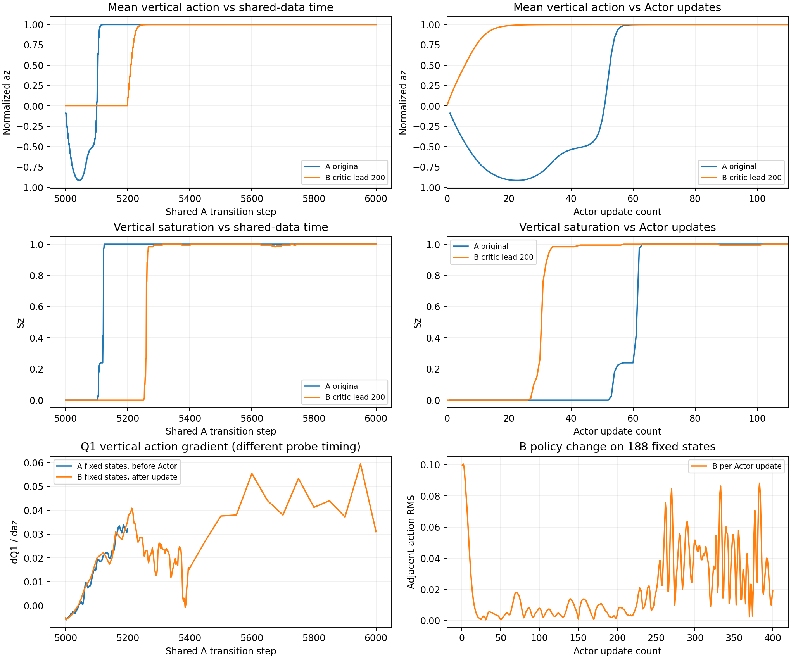
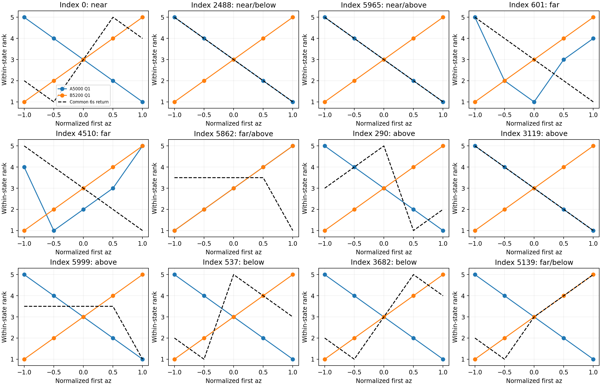

# Full Scratch EGO20x10 — D3 Critic Lead 200

实验：`full_scratch_ego20x10_d3_critic_lead_200`，2026-10-13，seed43。完成共享A行为数据的受控离线B组5k→6k；A组复用D1精确训练复现。正式训练配置、奖励、GRU、网络结构、地图池、成功半径均未改，test40未用于策略执行。

**结论：本次200次Critic先行没有改善策略崩溃，也没有建立更合理的垂直动作排序。** B在第57次Actor更新时即对188个固定状态全部正向垂直饱和，A为第63次；B的第63次与6k仍100%正饱和，L0均0/20。Critic在Actor完全不动时的共同后续控制6s排序一致率Q1由54.9%降至29.4%。这否定“当前协议下先学200次即可解决”的方案，不能否定所有Critic校准方法，也不能证明某一任务设计是唯一根因。

## 七个问题的直接回答

| 问题 | 结果 |
| --- | --- |
| Critic先行200次后排序改善吗？ | 没有总体改善。共同π5k、6s、12状态：Q1 54.9%→29.4%，Q2 45.1%→29.4%，min-Q 33.3%→29.4%；分组有升有降。 |
| B第63次Actor更新仍饱和吗？ | 是，5325步，188/188正向饱和，az均值约+0.99985。 |
| B6k仍崩溃吗？ | 是，400次Actor更新后仍188/188正饱和，az均值约+0.99997。 |
| L0能力保留或提高吗？ | 未保留。初始55%，B5325/B5600/B6000均0%。冻结阶段B5200保持55%仅因Actor未变。 |
| 是排序改善还是Actor更新减少？ | 没有改善需要归因；相同Actor次数下B更早饱和，不能把累计训练步后移188步当收益。 |
| 需要C Delay Only吗？ | 当前不需要；B没有达到事前“能力保留＋饱和降低”条件，无收益可分离。 |
| 值得进入短程真实在线验证吗？ | 当前方案不进入。完成诊断后停止，本轮无C、无在线6k/8k、无正式10k/20k。 |

## 1. 严格控制与训练预算

共同起点为原5k完整快照：Critic累计1次、Actor0次；Actor/target相同，Actor Adam尚无状态，Critic Adam保留已有一次更新状态。逐项保留原协议、三维Actor/双Critic/GRU、targets、Adam超参数、成功Replay297条、global RNG初态和课程/地图采样器来源。

| 项目 | A | B |
| --- | --- | --- |
| 原5k快照 | 同一份 | 同一份 |
| 5001–5200新增Critic/Actor | 200 / 100 | 200 / 0 |
| 5201–6000新增Critic/Actor | 800 / 400 | 800 / 400 |
| 6k累计Critic/Actor | 1001 / 500 | 1001 / 400 |

采样用A实际5001–6000主Replay前缀，所有main index均小于当时prefix size，没有未来数据。成功Replay在5k→6k期间没有新成功，297条数组完全相同。每批205主＋51成功，状态/动作/下一状态/已缩放奖励/终止mask及target noise共享。B使用自身actor_target/critic_target计算TD target，没有复制A的目标值。5001第一批B Critic loss和target均值与A完全相同；5200和6000实捕获输入/noise逐元素相同，TD target平均绝对差分别.01144、.05489，说明之后确实由不同网络产生。1000次Critic loss重构误差0，最终Torch smoothing RNG与A6k完全一致。

用**未改动的生产TD3.train**，只在前200次令隔离agent.actor_frozen=True。Critic target按total_it偶数做tau=.005 Polyak（先行阶段100次）；先行期间Actor和target Actor保持5k相同参数，Actor optimizer状态不变。第201次新增Critic更新时恢复标准联合更新（5201，Actor第1次）。测试验证偶数精确Polyak、奇数target不变。LR均3e−4、batch256、gamma.99、policy_freq2、noiseσ.2/clip.5、grad_clip_norm1.0不变。

原配置的policy_anchor_weight名义值0.1保留，但5k anchor对象为None，全程未建立/激活行为克隆锚定；实际anchor loss为0。未加载K1或Full微调权重。[事前协议](protocol.json)、[配置指纹](protocol_fingerprint.json)、[共享数据证明](shared_data_proof.json)、[训练证明](B/training_proof.json)。

离线分支不执行课程或采样新的行为Replay；课程和RNG初态由原5k来源封存，raw learner快照引用A的不可变Replay前缀和采样流。这些是共享数据诊断快照，不能冒充物理在线续训快照。真正在线分支须按原5k完整快照、新Full episode的续训语义另行启动。

## 2. 更新时序、三轴动作与梯度

每50次Critic更新及5043/5125/5200/5325等关键点保存raw四网络、优化器和计数；1000次记录固定188状态动作/Q分布。前100次Actor更新逐次记录局部三轴Q1/Q2/min梯度、logit、实际batch输出损失梯度/头部bias梯度及策略RMS。完整网络快照仅在关键/50步节点，并非每次Actor更新都保存网络。

| B上层数据步 | Actor次数 | Critic累计 | 动作均值(ax,ay,az) | 径向m/s | Q1/Q2均值 | 固定集dQ1/daz |
| --- | --- | --- | --- | --- | --- | --- |
| 5000 | 0 | 1 | (0.296, -0.024, 0.003) | +0.183 | -0.069 / -0.182 | -0.00501 |
| 5043 | 0 | 44 | (0.296, -0.024, 0.003) | +0.183 | -0.148 / -0.133 | +0.00075 |
| 5125 | 0 | 126 | (0.296, -0.024, 0.003) | +0.183 | -0.238 / -0.235 | +0.02167 |
| 5200 | 0 | 201 | (0.296, -0.024, 0.003) | +0.183 | -0.119 / -0.124 | +0.03558 |
| 5325 | 63 | 326 | (-0.806, -0.592, 1.0) | -0.318 | -0.163 / -0.254 | +0.02387 |
| 5600 | 200 | 601 | (-0.816, -0.573, 1.0) | -0.332 | -0.136 / -0.091 | +0.05539 |
| 6000 | 400 | 1001 | (0.63, 0.593, 1.0) | +0.193 | -0.562 / -0.608 | +0.03105 |

先行结束5200，Actor仍是初始策略，但固定集平均dQ1/daz已经从−.00501变为+.03558；Q1对x/y的平均梯度为−.04702/−.04129。首个Actor更新5201的实际batch dQ1/da均值为(−.04970,−.04362,+.03491)，输出损失梯度为(+.000194,+.000170,−.000136)，头部bias梯度为(+.04363,+.04193,−.03485)。梯度下降正是把XY推向负侧、Z推向正侧；并不是物理探索分布突然改变，因为本阶段共享行为数据不受B Actor影响。

输出损失梯度从实际backward hook记录；头部参数梯度是经过原grad_clip_norm=1.0处理后、优化器使用的梯度。二者处于不同梯度空间，不能简单将某一bias梯度视作整个策略变化量。

固定集az均值在第14次Actor更新（5227）超过+.9，第57次（5313）首次188/188正向饱和；A相应为第55次及63次。B从无先负后正的明显下探，直接利用先行后Critic的正Z梯度。5325时径向平均命令−.318m/s，XY也退化，不是单轴问题。

| Actor次数 | A数据步 | A平均az | A垂直饱和率 | B数据步 | B平均az | B垂直饱和率 | B径向m/s |
| --- | --- | --- | --- | --- | --- | --- | --- |
| 22 | 5043 | -0.915622 | 0.0% | 5243 | +0.992850 | 0.0% | -0.283 |
| 50 | 5099 | -0.179036 | 0.0% | 5299 | +0.999779 | 99.5% | -0.349 |
| 63 | 5125 | +0.999687 | 100.0% | 5325 | +0.999846 | 100.0% | -0.318 |
| 100 | 5199 | +0.999997 | 100.0% | 5399 | +0.999809 | 99.5% | -0.488 |

按数据步对齐：A5125已饱和，B此时没有Actor更新；B首次全饱和5313比A5125晚188个数据步。按Actor次数对齐：B57比A63更早，所以上述“晚188步”不能被解释为稳定性改善。按Actor次数比时B已经额外做过200次Critic更新；两种横轴都不能把所有机制压成一个变量。

A的22/50/63次后三维策略取下一次Actor前的已保存probe，Actor未变，但Critic已经再更新，因此该probe梯度不与B更新后的梯度直接配对；A100次取5200 raw probe。[两种对齐数据](actor_count_alignment.json)、[逐更新指标](B/updates.json)、[完整固定动作数组](B/fixed_policy_actions.npz)。

## 3. Critic排序与真实Full有限时域回报

复用D2的12个真实状态/重建动作前缀，世界距离/高度分组为near3、far4、above5、below4，分组重叠。同一状态首个动作固定D2原A6k XY，只扫az=[−1,−.5,0,.5,1]→世界vz=[−.3,−.15,0,.15,.3]m/s；XY仅固定**一个上层间隔**，后续控制可自由改变三轴，避免永久固定XY越界造成误判。

共同后续控制为冻结的原5k Actor；各自后续控制为对应checkpoint的Actor。B5200与原5k Actor完全相同，共同/各自返回同一物理轨迹；A6k各自后续的60条分支复用已校验的D2 fresh-reset产物。新增240条Full分支，每条均fresh reset＋原真实动作前缀；12状态观测重构误差0，同一首动作重复一步结果完全相同；不使用PyBullet save/restore。

每条90上层步同时提取30步/90步即2s/6s折扣回报，raw reward×.1、gamma.99，与Q量纲一致。早停后不继续积分，未终止不加Critic bootstrap，避免循环以Critic自己证明排序。每状态10个动作对，回报差<1e−6或Q差<1e−7的tie剔除，逐状态Spearman和top-action匹配另存。下面仅是有限诊断样本的一致率，动作对相关，不能按120个独立样本作总体显著性论断。

| checkpoint | 后续控制 | 时域 | Q1一致率 | Q2一致率 | min-Q一致率 |
| --- | --- | --- | --- | --- | --- |
| A5000 | common | 2s | 49.0% | 41.2% | 39.2% |
| A5000 | common | 6s | 54.9% | 45.1% | 33.3% |
| A5000 | own | 2s | 49.0% | 41.2% | 39.2% |
| A5000 | own | 6s | 54.9% | 45.1% | 33.3% |
| A5200 | common | 2s | 45.1% | 45.1% | 45.1% |
| A5200 | common | 6s | 29.4% | 29.4% | 29.4% |
| A5200 | own | 2s | 3.9% | 3.9% | 3.9% |
| A5200 | own | 6s | 3.9% | 3.9% | 3.9% |
| B5200 | common | 2s | 45.1% | 45.1% | 45.1% |
| B5200 | common | 6s | 29.4% | 29.4% | 29.4% |
| B5200 | own | 2s | 45.1% | 45.1% | 45.1% |
| B5200 | own | 6s | 29.4% | 29.4% | 29.4% |
| B5325 | common | 2s | 30.4% | 49.0% | 49.0% |
| B5325 | common | 6s | 28.4% | 33.3% | 33.3% |
| B5325 | own | 2s | 32.9% | 7.6% | 7.6% |
| B5325 | own | 6s | 32.9% | 7.6% | 7.6% |
| A6000 | common | 2s | 37.3% | 52.0% | 37.3% |
| A6000 | common | 6s | 33.3% | 36.3% | 33.3% |
| A6000 | own | 2s | 47.2% | 20.8% | 47.2% |
| A6000 | own | 6s | 46.8% | 21.6% | 46.8% |
| B6000 | common | 2s | 31.4% | 48.0% | 52.0% |
| B6000 | common | 6s | 27.5% | 32.4% | 36.3% |
| B6000 | own | 2s | 51.8% | 27.3% | 35.5% |
| B6000 | own | 6s | 44.9% | 32.7% | 41.1% |

B先行完成时，共同6s的Q1为30/102非tie动作对一致，初始为56/102；A5200与B5200排序统计完全相同，虽然Q数值不同。B自己的Actor尚未变化，依然没有建立可靠的诊断排序；但共享流本身包含A更新后采集的失稳经验，所以没有排除A行为数据质量的作用。共同2s的min-Q有39.2%→45.1%的局部提升，而6s三种Critic通道均下降，不能声称所有指标都恶化。B6k各自6s整体Q1/min-Q为44.9%/41.1%，与A6k各自46.8%/46.8%相比没有明确改善；各自控制的真实回报不同，不能用A回报替代B真值。

| checkpoint | 世界分组 | 状态数 | 共同2s Q1一致率 | 共同6s Q1一致率 |
| --- | --- | --- | --- | --- |
| A5000 | near | 3 | 73.3% | 73.3% |
| A5000 | far | 4 | 42.9% | 28.6% |
| A5000 | above | 5 | 68.4% | 78.9% |
| A5000 | below | 4 | 29.4% | 47.1% |
| B5200 | near | 3 | 26.7% | 26.7% |
| B5200 | far | 4 | 35.7% | 14.3% |
| B5200 | above | 5 | 21.1% | 10.5% |
| B5200 | below | 4 | 70.6% | 52.9% |
| B5325 | near | 3 | 26.7% | 26.7% |
| B5325 | far | 4 | 35.7% | 14.3% |
| B5325 | above | 5 | 34.2% | 28.9% |
| B5325 | below | 4 | 11.8% | 29.4% |
| B6000 | near | 3 | 30.0% | 30.0% |
| B6000 | far | 4 | 35.7% | 14.3% |
| B6000 | above | 5 | 36.8% | 26.3% |
| B6000 | below | 4 | 11.8% | 29.4% |

目标下方组有局部改善，近目标、目标上方及全体6s没有总体改善，不能声称每个状态/分组都恶化。共同后续控制在B5200就是自身策略，是最直接的先行Critic诊断；B5325/B6000对共同π5k仅是跨组参照，不是其自身无限时域Q真值。部分代表性状态采自原A后续5k→6k，对5200而言尚未进入Replay；因此该集合也含分布外诊断。当前Critic学的是平滑target策略，实测为确定性有限时域，二者仍有差异；90步回报不能当无限时域Q真值。

完整Q1/Q2/min扫描、Actor实际选择动作及其价值、每候选真实轨迹见[paired_values.json](paired_values.json)；逐状态排序及tie为[ranking_pairs.json](ranking_pairs.json)，分组为[ranking_summary.json](ranking_summary.json)，重建证明为[physical_proof.json](physical_proof.json)。

## 4. 同图Full导航评估

validation20固定Stage0地图；L0使用相同QA剩余路径约.8m起点，原始任务固定[-8,0,1]→[8,0,1]。所有reset初速度0，成功严格<.2m、引导<1.2m、40s和终止优先顺序原样。所有候选策略重新评估；B5200从hash相同A5000复用。原A5000/A6000全部逐图L0/16m结局与D1既有数据一致。

0.3/.5到达、最小终距、参考跟踪误差在本轮均按120Hz下层记录；不改变正式成功条件。每回合保存upper动作/位置/速度和lower位置/速度/Reference/终距/接触，记录真实净空和入区时间/速度。

| checkpoint | 任务 | .2成功 | .3到达 | .5到达 | 碰撞 | XY越界 | 高度越界 | timeout | 平均最小终距m | 跟踪误差均值m |
| --- | --- | --- | --- | --- | --- | --- | --- | --- | --- | --- |
| A5000 | L0 | 11/20 | 15/20 | 17/20 | 0 | 9 | 0 | 0 | 0.293 | 0.0073 |
| A5000 | original16m | 0/20 | 0/20 | 0/20 | 1 | 0 | 0 | 19 | 13.620 | 0.0009 |
| B5200 | L0 | 11/20 | 15/20 | 17/20 | 0 | 9 | 0 | 0 | 0.293 | 0.0073 |
| B5200 | original16m | 0/20 | 0/20 | 0/20 | 1 | 0 | 0 | 19 | 13.620 | 0.0009 |
| A6000 | L0 | 0/20 | 3/20 | 5/20 | 2 | 18 | 0 | 0 | 0.525 | 0.0197 |
| A6000 | original16m | 0/20 | 0/20 | 0/20 | 1 | 0 | 19 | 0 | 11.940 | 0.0156 |
| B5325 | L0 | 0/20 | 0/20 | 0/20 | 6 | 0 | 14 | 0 | 0.746 | 0.0170 |
| B5325 | original16m | 0/20 | 0/20 | 0/20 | 1 | 19 | 0 | 0 | 16.000 | 0.0204 |
| B5600 | L0 | 0/20 | 0/20 | 0/20 | 4 | 0 | 16 | 0 | 0.746 | 0.0165 |
| B5600 | original16m | 0/20 | 0/20 | 0/20 | 1 | 19 | 0 | 0 | 16.000 | 0.0207 |
| B6000 | L0 | 0/20 | 2/20 | 4/20 | 3 | 17 | 0 | 0 | 0.532 | 0.0199 |
| B6000 | original16m | 0/20 | 0/20 | 0/20 | 5 | 0 | 15 | 0 | 13.113 | 0.0238 |

相对初始A5k：B5325/B5600/B6000均失去原11个成功图，新增成功0，保持失败9；同图二项discordance检验p≈.000977，描述的是这20图上的退化，不是四seed泛化。相对A6k：B6k成功同为0，不能宣称成功率改善；L0失败组成从18XY＋2碰撞变为17XY＋3碰撞，.3/.5入区还从3/5降为2/4。

原始16m：B5325/B5600的19图XY越界，是负XY偏置导致倒退；B6k为15高度越界＋5碰撞，平均最小终距约13.113m，A6k约11.940m。高度失败数量较少伴随碰撞更多和更早终止，不能据此声称更安全。无策略在16m成功或进入1.2m。跟踪误差为厘米量级且动作对应实际运动，未观察到能解释崩溃的下层失控。

[逐图配对变化](paired_validation_changes.json)、[导航指标](validation_summary.json)、[完整逐回合记录](validation.json)、[原始轨迹](validation_traces)。固定5k的55%只是未训练Actor恰在这些近目标图上的能力；B5200保持55%是冻结恒等，不是学习成功。

## 5. 根因证据与后续决策

**已证实：** 共享数据/noise/优化超参数下，前200次Actor不动没有改善本集合的共同控制6s排序；解除冻结前Q1的三轴梯度已明显偏向负XY/正Z。Actor实际损失梯度沿这些方向更新，第57次全部正饱和。第63次到6k没有恢复，L0原能力丢失。它不是B探索恰好采到坏轨迹，因为B在受控阶段没有采集自己的训练经验。

**较强解释：** 当前早期数据、奖励/表示及TD目标组合仍产生不可靠局部动作斜率，Actor快速放大该斜率；“Critic只需比Actor早学200次”不足。Critic是否长期需要更多覆盖、Actor步幅是否过大、target滞后作用仍未分离；结果不能简单选定“Critic太慢”或“Actor太激进”中的唯一答案。

**未验证：** 改Actor LR、梯度上限、延长预热、修正M0任务契约能否恢复学习；不同训练seed及真实在线分布反馈是否会改变结论。本轮不能证明critic lead对所有种子有害，也不建议机械增加到500/1000次。

本结果仅约束固定A行为数据上的先行机制。B若在线采集自己的经验，可能形成不同Replay及成功样本；这种反馈未测试，不能把离线负结果等同于所有在线方案必然无效。本轮仍按事前顺序不启动在线分支。

按事前规则，B未达到L0至少9/20且相对A6k净增至少5图、Actor63和6k饱和率<50%的能力保留条件。因此不补C，不进入独立在线5k→6k/8k；没有执行任何正式10k/20k续训。C未来用于有收益时分离“Critic提前学习”与“仅延迟联合更新”，当前没有收益可分离。[决策记录](decisions.json)。

下一步应优先审查早期Replay状态—动作覆盖、少数成功轨迹和终止target对Critic更新的贡献、输入尺度及M0契约。若后来能先证明局部价值排序有所改善而Actor仍迅速退化，才把D4 Actor LR 3e−4 vs1e−4作为独立机制对照。本轮不修改M0发现的目标截断、引导速度域、近目标罚分或gamma，不加入K1/行为克隆。

## 6. 产物、校验与复现

独立目录保留raw网络/Adam/targets、每更新动作数组、Q分布/梯度/TD误差、Replay来源、配置指纹、逐图结果、科学图PNG/PDF。完整来源204份文件SHA256前后未变，A没有重新训练；B新增Critic1000/Actor400，仅受控离线消融。3项测试通过：采样拒绝未来转移、实际A第一批target/critic loss相同并验证冻结与target节拍、Q排序tie处理。

入口：[运行脚本](../../scripts/run_ego20x10_d3.py)、[物理/导航评估](../../scripts/evaluate_ego20x10_d3.py)、[汇总脚本](../../scripts/summarize_ego20x10_d3.py)、[测试](../../tests/test_ego20x10_d3.py)。先`run_ego20x10_d3 train`，再`evaluate_ego20x10_d3 values/evaluation`，最后汇总。运行脚本首次要求新目录，可指定`--output`；本次原目录不可重复覆盖。C入口存在但未调用，在线入口本轮未实现/未运行。
