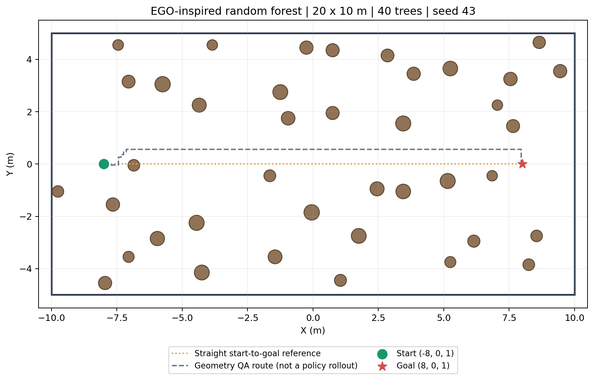
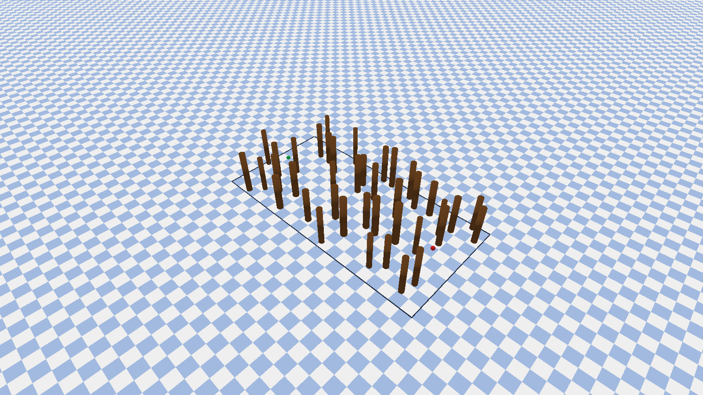

# EGO 风格 20×10m 随机森林实例

2026-10-13。已生成并注册 `ego_forest_20x10_seed43_v1`，位于主 atlas 的 `development` split。采用 EGO 风格的二维均匀中心采样、网格对齐和最小中心间距，在本项目中生成精确 PyBullet 圆柱；没有移植 ROS，也不声称逐点复现 EGO C++ 点云或 RNG。

## 地图与实际产物

| 参数 | 当前实例 |
|---|---|
| 任务区域 | X∈[-10,10]m，Y∈[-5,5]m，20×10m 矩形 |
| 树木数 | 40，粗略密度 0.20 株/m² |
| 树干直径 | 0.4–0.6m，显式物理尺寸 |
| 树高 | 3–4m，圆柱底面在 z=0 |
| 中心最小水平间距 | 1.0m |
| 中心采样网格 | 0.1m；几何仍是连续圆柱 |
| 起终点排除区 | 树表面距起点/目标水平位置至少 0.8m |
| 种子 | 43；独立 NumPy RNG；68 次采样放置 40 棵树 |
| 起点 / 目标 | [-8,0,1] / [8,0,1]，直线航程16m |
| 感知范围 | 1.75m；Full 检查使用32方位×3仰角=96 rays |
| episode 预算 | 40s；按0.8m/s命令上限，直线理想时间20s，另留避障/捕获时间 |
| 课程 | 此静态实例关闭课程与简单难度混合，没有强制挡路树或保护走廊 |
| 保守几何检查路径 | 17.144m；z=1m、0.1m栅格，车辆半径0.06m，附加净空0.20m及半格对角 padding |

该路径只是地图可行性检查数据，未传入观测、策略、Replay 或奖励，也没有用训练后的 Actor 执行它。几何可达不等于 Full 下已经能够完整导航。当前实例的密度低于旧紧凑 Stage 3 森林，航程更长；这是一个开发样例，不据单图宣称任务更难或策略泛化通过。

- 独立 atlas：`data/map_atlas/generated/ego_forest_20x10_seed43_v1/map_catalog.json`
- 参数、来源、几何 SHA256 与物理验证：同目录 `manifest.json`
- 几何检查路径：`qa_route.json`
- 俯视图：`map_xy.png`
- 实际 PyBullet 视图：`map_pybullet.png`
- 旧场景兼容检查：`legacy_compatibility.json`

几何 SHA256：`56f6d6b3f5962029d18ba79d97e4341bf0898f14b669e8d7a8a2dcfce8a1a1bf`。





## 工程变更与验证

`MapSpec` 新增可选 `xy_half_extents` 与 `episode_len_sec`；旧单一方形字段保留。地图路线检查、端点检查采用矩形范围；`CustomForestAviary` 对矩形实例采用各轴独立越界判断，并加载地图自己的时间预算。新森林的20×10m边界是任务边界，不是树木外包围盒或物理墙体。旧地图继续沿用旧越界 margin。

`ForestLayoutConfig` 也支持独立 X/Y 半尺度；旧方形生成没有改变。`ego_forest.py` 是新的独立生成器，保存已经采样完成的静态圆柱规格，使 reset 的环境 seed 不会重新生成这份固定地图。需要不同地图时，生成不同种子的实例，而不是误把同一静态地图反复 reset 当成不同地图。

物理检查通过：

- reset 位于[-8,0,1]且无碰撞，40个实际树木碰撞体。
- 射线命中指定树木；把UAV放到该树内部后真实碰撞标志成立，证明传感器与碰撞使用同一树体。
- 917D Full 观测、15Hz上层/120Hz下层；60个零速度命令上层步执行480个下层tick，ReferencePacket有效，状态和奖励有限，无异常终止。
- X超过10m或Y超过5m独立触发越界；40s预算不会在旧12s时提前超时。
- 19项相关测试通过，包含生成器固定种子、树间距、边界、保守路径线段净空、不可放置参数的有限预算失败、矩形障碍无法绕出短轴逃逸、Full地图加载及旧地图/课程回归。
- 对比修改前的 `HEAD:envs/forest/layout.py`，seeds0/43/80、受保护/非受保护两种设置共6组，旧地图坐标、半径、高度逐项完全相同。

图中的矩形边线、起点绿球和终点红球是仅用于展示的无碰撞视觉标记；没有混入地图障碍物或传感器几何。未启动训练，没有加载/修改任何既有checkpoint。

## 生成和加载

生成命令（已执行；默认拒绝覆盖已有输出或注册ID）：

```bash
cd /home/tequila/UAV-Latent-RL
OMP_NUM_THREADS=2 MKL_NUM_THREADS=2 MPLCONFIGDIR=/tmp/mpl-ego-map \
/home/tequila/miniconda3/envs/drones/bin/python -m scripts.generate_ego_forest_map \
  --seed 43 --x_size 20 --y_size 10 --trees 40 \
  --register_catalog data/map_atlas/catalog_v1.json
```

另一个种子可用 `--seed 44`，会创建独立输出目录；加 `--gui` 可在验证完成后保持可视化窗口。主atlas注册可选。生成器对无法放置或不能通过保守路线检查的请求报错，不在后台无限重采样一个更容易的种子。

代码加载已注册地图：

```python
from envs.map_atlas import MapCatalog
from envs.learned_upper_dslpid import LearnedUpperDSLPIDForestEnv

spec = MapCatalog("data/map_atlas/catalog_v1.json").get("ego_forest_20x10_seed43_v1")
env = LearnedUpperDSLPIDForestEnv(
    map_spec=spec, pyb_freq=240, ctrl_freq=120, gui=False,
    range_azimuth_count=32, range_elevation_degrees=(-30, 0, 30),
    semantic_history_length=8,
)
obs, info = env.reset(seed=43)
env.close()
```

此图关闭 `route_count_curriculum`，不能直接替换 `full_scratch_curr_v1` 的训练地图后继续旧课程。本轮只交付地图及课程适配说明，尚未注册新训练模式。

## 起点课程、障碍课程需要怎样调整

**需要调整课程参数和地图连接方式，晋级原则可以复用。** 地图面积本身不是起点课程依据；这次原始起点距离从7m变为16m，并且可行路线约17.14m，旧课程中4.5–7m的最后一档不足以覆盖完整路径。

建议的新起点课程保留四个短起点等级及最终原始起点级：

| 等级 | 采样范围（沿可行路径的剩余长度） |
|---|---|
| L0 | 0.35–1.2m |
| L1 | 1.2–4m |
| L2 | 4–8m |
| L3 | 8m–当前实例完整可行路径长度 |
| L4 | 固定原始[-8,0,1]起点 |

这些是建议参数，尚未实现或用训练证据选择。保留最初近目标档以先积累真实Full成功经验，晋级仍以完成回合的成功/碰撞窗口判定，不按固定训练步强推。需要把目前写死的 `START_DISTANCE_BANDS` 参数化，并让路径规划、候选点边界检查遵守20×10m矩形，支持静态圆柱规格；原helper仅接受带`xy/radius`的旧树木记录，当前静态atlas记录不能直接使用它。GRU/PID/reference在课程重定位后仍按既有reset契约初始化。

**障碍课程不能继续把原1/2/3/5棵“强制挡路树”标签当作这40棵自然随机树的难度。** 对新森林优先考虑同一区域的密度课程，例如Stage0–3分别激活10/20/30/40棵树。可从冻结的40棵几何池构造嵌套子集，每个阶段检查起终点和路径净空，先用起点课程学完整距离，再固定原始16m起点增加树木数量。此实例全树集合已有可行路径，其障碍子集不会破坏该路径；其他新生成实例仍须验证。

当前 `ObstacleCurriculum` 的成功率、碰撞率、最小回合数等门槛机制可以作为基线复用，但必须将实际“主难度”标识接到活跃树木数/密度，而非当前`route_blocking_tree_count`，也要明确容易阶段保留是否启用。旧阈值在新任务上只是初始候选，需要短冒烟和早期学习观察。

若选择保留原来的1/2/3/5挡路树课程，也应另外明确背景树数量与路线注入机制；这样生成的是新的课程地图族，而不是本轮未注入路线树的EGO风格固定样例。面积、密度、树干尺寸和起点距离分开控制，便于解释效果。

后续新训练协议还应单独审计：更长episode的折扣时域、全局位置/目标归一化的尺度变化、原始16m固定评估以及未参与选模的地图实例。917D维度相同不等于旧网络输入分布相同。本轮没有把奖励或GRU改动混入地图生成。
