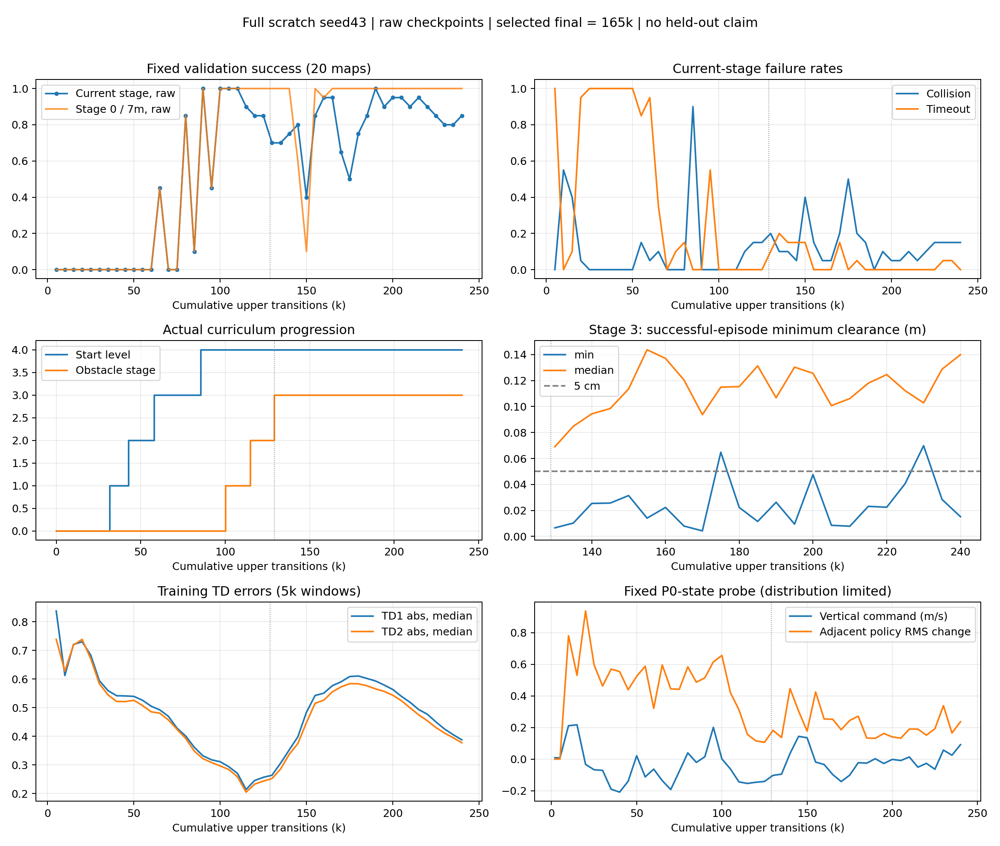

# full_scratch_curr_v1 seed43：240k 首轮结果审计

2026-10-13。用户提到“24k”；目录、日志与完整续训快照一致证明实际累计为 **240,000 条上层转移**，不是 24,000。本轮只读取训练产物、做离线统计并独立重评原始末尾策略，没有继续训练、修改奖励或 GRU、覆盖训练 checkpoint。

**结论：seed43 已证明 Full/DSLPID 从零训练能够通过起点与障碍课程，学会原始 7m 五树导航。尚未证明多 seed 可复现、未参与选模地图泛化或足够的安全裕度。后期有回退，成功轨迹也存在毫米/厘米级擦树。**

## 三个 checkpoint 必须区分

以下均为固定验证地图 `procedural_forest_multitree_validation_random_v1`，环境 seeds 0–19，原始 7m 起点，Full/DSLPID，20 回合。它们参与周期选模，不是 held-out。

| 网络 | 来源 | Full Stage 3 成功 | 碰撞 | timeout | Stage 0 / 7m 成功 | Stage 3 最终距离均值 | 位置跟踪 RMSE |
|---|---:|---:|---:|---:|---:|---:|---:|
| `model_final` = `model_best` | 165k | 19/20（95%） | 1/20 | 0 | 20/20 | 0.449m | 0.0319m |
| `model_peak_validation` | 190k | 20/20（100%） | 0 | 0 | 20/20 | 0.198m | 0.0285m |
| `model_raw_final` = `model_240000` | 240k | 17/20（85%） | 3/20 | 0 | 20/20 | 0.949m | 0.0286m |

Actor 和 Critic 的张量哈希均确认上述等式。完整 `training_state.pt` 中的在线网络对应原始 240k，包含正确的 target、优化器、Replay、课程状态；它不是恢复后的 165k 网络。

best 使用连续两次评估窗口及字典序评分。160k/165k 的窗口平均成功率 95%、碰撞率 5%，选中 165k；190k 是单次峰值，没有自动替换该稳定窗口 best。这解释了为什么最后保存的 `model_final` 并非 190k 或 240k。

## P1 早期学习：成功经验存在，但并不平稳

原配置 `start_timesteps=5000`、`update_after=5000` 保持不变；P0 的 2k 之后先续到 10k，再续到 240k。三个 TensorBoard 文件分别覆盖完整回合结束步 181–1822、2181–9938、10014–239896，符合回合边界续训设计。

| 累计步区间 | 完整训练回合 | 成功 | 近目标 band 成功 | 原始起点成功 | 主要观察 |
|---|---:|---:|---:|---:|---|
| 0–2k | 11 | 2 | 2/9 | 0/2 | 随机探索可产生真实成功 |
| 2k–5k | 18 | 2 | 2/13 | 0/5 | 更新前仍能积累成功 |
| 5k–10k | 72 | 27 | 27/60（45.0%） | 0/12 | 开始学习，但高度/XY 越界明显 |
| 10k–20k | 121 | 56 | 56/97（57.7%） | 0/24 | 已形成近目标成功经验 |
| 20k–24k | 22 | 0 | 0/19 | 0/3 | 全部 timeout，出现短期回退 |
| 24k–32k | 103 | 74 | 74/83（89.2%） | 0/20 | 近目标能力恢复，随后通过 L0 |

回合按结束步归入区间，非按每个 transition 切分。首次在更新开始后结束的成功回合为第 5,126 步，但不能把这单次成功完全归因于刚发生的更新。成功 Replay 在 5k/10k/20k/24k 分别为 286/721/2091/2091 条；20k–24k 未继续增加。不存在“20k 完全没有有效成功经验”的情况，但若当时只看到 24k，应该先检查这一段 timeout 回退，而不能声称 P1 已平稳完成。

固定 7m 评估在 5k–60k 均为 0/20。10k 原始策略有 11 次碰撞、9 次 XY 越界；15k 有 8 次碰撞、3 次高度越界、7 次 XY 越界、2 次 timeout；20k 为 1 次碰撞、19 次 timeout，最终目标距离均值 2.587m。训练近目标成功率和完整距离评估不能混用。

## 课程确实完成了距离与障碍扩展

以下为 reset 日志中第一次使用新等级/阶段的累计步数，课程门槛未按步数强制推进。

| 事件 | 实际累计步 |
|---|---:|
| L0 → L1 | 31,760 |
| L1 → L2 | 42,893 |
| L2 → L3 | 58,111 |
| L3 → L4，之后全用原始 7m 起点 | 85,676 |
| Stage 0 → 1 | 100,282 |
| Stage 1 → 2 | 114,831 |
| Stage 2 → 3 | 128,958 |
| 第一次 Stage 3 周期评估 | 130,000 |

65k 首次在固定 7m Stage 0 获得 9/20 成功，80k 为 17/20，90k 首次 20/20。这中间并不单调：70k 全部高度越界，75k 有 18/20 高度越界，85k 有 18/20 碰撞。95k 的 Stage 0 又退到 9/20，100k 恢复到 20/20。

Stage 3 首次评估为 14/20；160k/165k 达到 19/20，190k 达到 20/20。总体证明了完整动力学下的学习可行性，而不是仅在近目标训练分布上成功。与此前 K1 的 132k–156k 首次 Stage 3 周期评估时间相比，这个 Full seed 没有出现明显课程进度延迟；单 seed 和不同评估间隔不足以得出收敛速度优劣结论。

## 后期回退没有被 best 恢复掩盖

| 原始 checkpoint | Stage 3 成功 / 碰撞 / timeout | Stage 0 / 7m 成功 |
|---|---|---:|
| 130k | 70% / 20% / 10% | 100% |
| 150k | 40% / 40% / 15%（另 5% XY 越界） | 10% |
| 165k | 95% / 5% / 0% | 100% |
| 175k | 50% / 50% / 0% | 100% |
| 190k | 100% / 0% / 0% | 100% |
| 220k | 90% / 10% / 0% | 100% |
| 230k | 80% / 15% / 5% | 100% |
| 240k | 85% / 15% / 0% | 100% |

150k 同时退化了简单场景与复杂场景；175k 的退化主要表现为 Stage 3 碰撞。它们不应被合并为一种已经确认的机制。原始 240k 相对 165k 在同图上丢失 seeds 0、1 的成功，没有新增成功；相对 190k 丢失 seeds 0、1、6。

19–22 万步训练回合为 192/204 成功（94.1%）；22–24 万步为 123/139（88.5%）。这些是含噪训练表现，支持后段存在一定退化，但不是独立泛化评估。

## 安全净空：高成功率仍会擦树

统计单位是**每个成功回合中，所有 120Hz 下层 tick 的最小树木净空**；下表再对这些回合最小值取分位数。没有把碰撞回合混入“成功安全裕度”，也没有用大量远离树木的 tick 稀释擦树风险。净空是环境基于无人机碰撞尺寸计算的几何量，接触仍以真实碰撞标志判断。

| 网络 | 成功回合数 | 最差成功净空 | 成功回合最小净空 P05 / 中位数 | <1cm | <5cm | <10cm |
|---|---:|---:|---:|---:|---:|---:|
| 165k best/final | 19 | **0.80cm** | 2.93 / 12.05cm | 1 | 4 | 8 |
| 190k peak | 20 | **2.63cm** | 5.64 / 10.68cm | 0 | 1 | 9 |
| 240k raw | 17 | **1.52cm** | 4.24 / 13.99cm | 0 | 2 | 5 |

这些阈值用于描述分布，不是本次临时设定的通过标准。190k 在这 20 张图上成功率更高，但单次峰值不是预注册稳定窗口选择，不能事后无条件换成新的正式 best。best 的一次 8mm 净空尤其说明：当前 best 评分没有显式保证安全裕度。

原始 240k 的三个碰撞来自 seeds 0、1、6。现有末 2s 启发式窗口分别标为 C/A/C：局部指令振荡 / 未出现减速或避让命令 / 局部指令振荡。碰撞前最终平面命令约 0.80m/s，实际速度约 0.815/0.611/0.657m/s。它们说明值得检查局部避障动作与真实响应；分类标签不是因果证明，不能据此立即归因于 PID 或修改奖励。

## Actor/Critic 稳定性与更新机制

完整快照及逐更新 JSONL 对齐：**235,001 次 Critic 更新、95,833 次 Actor 更新**，更新步连续覆盖 5,000–240,000，Actor 冻结记录为 0，数值日志未发现 NaN/Inf。主 Replay 为 60,000；成功 Replay 的 1/2/3/5 树四层各 5,000。初始 Actor/Critic 哈希仍与 P0 记录一致。证据支持此次从 2k → 10k → 240k 正确保留了学习进度，不是通过普通加载重新开始计数。

110k 首次达到稳定窗口后，按继承的基线逻辑进入 conservative phase；首次按新设置更新发生在 110,001：Actor/Critic LR 从 3e-4 降为 1e-4，target policy noise 从 0.20 降为 0.10，Actor 更新间隔从 2 改为 3，并保留既有成功经验策略锚定。这不是 Full FT Actor 冻结，也不是本轮审计新增的超参数变化。

| 更新区间 | Critic loss 中位数 | TD1 绝对误差均值的中位数 | Q1 minibatch 均值的中位数 |
|---|---:|---:|---:|
| 5k–10k | 6.922 | 0.612 | -0.509 |
| 15k–20k | 3.351 | 0.730 | 8.422 |
| 105k–110k | 0.527 | 0.270 | 8.577 |
| 145k–150k | 1.305 | 0.484 | 6.441 |
| 170k–175k | 1.797 | 0.608 | 1.608 |
| 235k–240k | 0.671 | 0.388 | 1.795 |

没有发现持续无界的数值爆炸，但也不能凭 loss 有限断言 Critic 正确。梯度日志记录的是裁剪前范数，早期 Critic 范数较大，不等价于实际执行了同等幅度的参数更新。初期策略变化很大：固定 probe 的相邻策略 RMS 在 20k 为 0.938；末尾 240k 为 0.237，说明后期仍有策略漂移。

固定 probe 是 P0 前 256 条状态及**当时的随机动作**。该集合中的 Q 到后期明显偏负，例如 240k 的 Q1/Q2 中位数为 -14.33/-22.18。这不是当前策略在当前访问分布上的 Q，不能直接读成“任务整体价值崩溃”。同理，固定 probe 的高 XY 边界比例不能直接等同当前轨迹上的全程动作饱和。

为进一步检查，在 165k/190k/240k 的实际评估轨迹上读取当时 Critic，并与相同轨迹的已实现折扣回报对照（gamma=0.99，reward_scale=0.1；本次这三个策略的 Stage 3 回合都真实成功或碰撞，无 timeout 截断）：

| checkpoint | 访问状态数 | 实现折扣回报均值 | Q1 均值 | Q1 减实现回报的均值 |
|---|---:|---:|---:|---:|
| 165k | 2,979 | 12.033 | 3.252 | -8.781 |
| 190k | 3,016 | 12.595 | 0.077 | -12.517 |
| 240k | 2,621 | 10.845 | 0.801 | -10.044 |

Q2 也有类似偏低。这提示价值标定问题值得单独审计；不过 TD3 的 target smoothing、历史训练策略与当前策略分布不同，而且这里每个部分可观测历史只有一次实现回报，所以这不是“真实最优 Q”的无偏检验，也不是后期回退原因已经确定。190k 反而是 20/20 成功，说明不能用 Q 的绝对水平简单预测成功率。

实际 Stage 3 引导区轨迹的回合均值显示，165k/190k/240k 径向闭合速度约 0.585/0.642/0.735m/s，垂直实际速度约 -0.021/-0.010/+0.015m/s。原始末尾策略总体更快接近终点，未表现为统一的末端垂直逃逸；末尾失败集中在途中碰撞。不同成功/到达集合仍需注意选择偏差。

## 日志解释和可复核性

`evaluation_metrics.jsonl` 与 Stage 0 文件各有 50 条记录，实际 48 个周期 checkpoint；10k 和 240k 各有两条。两次重复都是训练结束后加载选中模型再评估：10k 后重评的是 5k 的 peak，240k 后重评的是 165k 的 best。若简单按 step 取最后一条，会把 10k 原始退化抹掉，并把 240k 原始成功率错误写成 95%。本分析按文件顺序取第一次为原始周期评估，把额外记录单列。

更重要的是，训练结束重评沿用 `step_XXXXXXX` 目录，覆盖了该步原始逐 tick 轨迹。原始评估 JSONL 仍在，原始网络也仍在；本轮已将原始 240k 单独加载到评估模式，在相同 20 张图重跑。终止原因和最终距离逐图匹配原始周期记录，输出至独立 review 目录，恢复了原始末尾净空证据。历史 10k 的原始逐 tick 轨迹未在本轮重跑，因此其结论仅使用未丢失的原始 JSONL，不混用覆盖后的 trace。

独立重评工具内部输出 `Eval @ 5000` 是评估 callback 的调度标签；`raw240k_stage3/config.json` 明确加载 `model_raw_final`，并以网络哈希与原始 240k 逐图结果核对，不把标签当成训练步数。后续应把原始评估和 selected-final 评估分到不同目录、记录来源 checkpoint；本轮未改动训练器或既有评估数据。

## 本轮判断与下一步

1. **可行性成立（限 seed43）**：Full 从零训练能够完成课程并形成原始起点 Stage 3 能力，当前没有证据要求立即更改奖励或 GRU。
2. **保持 240k 预算结束状态**：不建议因单次末尾 85% 就盲目加长该 seed；同时保留 165k 稳定 best、190k 单次 peak、240k raw，不能只留 `model_final`。
3. **验证与安全仍未完成**：固定协议后扩展 seed42/44/45；统一报告每个 seed 的 selected、raw 和安全净空，再完成未参与选模地图评估。当前 20 图结果不能替代该步骤。
4. **优先机制审计方向**：复核 Critic 回报标定、局部动作排序及高速度低净空碰撞；修正评估产物同 step 覆盖的可追溯性问题。保持实验机制不变直至审计证据支持修改。
5. **尚未进行 K1→Full 正式比较**：本轮没有把当前选模地图成功率与此前不同地图集/不同 seed 的零样本成功率直接排名。四 seed 固定协议完成后再进行同图配对。

## 产物

- 汇总与全部原始/恢复评估分离记录：`analysis_outputs/full_scratch_curr_v1_seed43_review_20261013/summary.json`
- 学习、课程、净空和稳定性曲线：`analysis_outputs/full_scratch_curr_v1_seed43_review_20261013/learning_audit.png`
- 原始 240k 独立重评：同目录 `raw240k_stage3/`（配置、逐图指标、完整上下层 trace、碰撞窗口）
- 实际访问状态 Q/实现回报诊断：同目录 `visited_state_q_diagnostic.json`
- 可复算统计入口：`scripts/summarize_full_scratch_run.py`（读取已有重评文件，无训练更新）

